# 실물 평가 3 — 실험 4개 단계 평가 S0–S9: 실물 100판 · 실물 200판 · 실물 + 시뮬 · VLA + 수식 (Franka FR3, 2026-11-05 ~ 11-12)

> 앞선 결과는 [`../FR3_results_benchmark/`](../FR3_results_benchmark/)(11-02 평가 40회)와 [`../FR3_results/`](../FR3_results/)(11-05 v1·v2 비교, 실패 원인 분석)에 있습니다. 이 폴더는 **지금까지 한 실험 4개를 같은 단계 평가표(S0–S9)로 다시 채점해 비교**합니다.
>
> - 과제: Franka FR3가 빨간 튜브를 집어 빨간 링으로 표시한 빈 랙 구멍에 꽂기 (지시문 "put the red tube in the red slot")
> - 평가: 수집에 쓰지 않은 배치 T01–T10, 판마다 처음 막힌 단계를 정함 (평가는 튜브가 빨간 링 구멍에 들어가는 순간 S9까지)
> - 자료: 로봇 PC 실행 기록(손끝 실제·명령 위치 10 Hz, 그리퍼 폭·명령, 시작·끝 장면), 11-05 실패 판 사진·메모 검토, 사람 판정

**English summary.** We re-scored every trial of four real-robot experiments on ten held-out layouts (T01–T10) with a stage-wise rubric S0–S9 (S9 = the red tube is inserted into the red-ringed slot). **E1** — GR00T N1.7 fine-tuned on 100 scripted real demonstrations: 1/20 success (5%, Wilson 95% CI 1–24%). **E2** — 200 real demonstrations: 6/20 (30%, 15–52%); the gain came from reaching and grasping the red tube (cumulative S4 30% → 75%, Fisher p = 0.01). **E3** — 200 real + 600 simulated demonstrations: 2/18 (11%, 3–33%), stopped early; the evaluation layouts were not placed as on the E2 day (racks 10–30 mm and up to 7° off), so this run cannot judge the effect of the simulated data. **E4** — the E2 model unchanged plus a scripted hand-off that takes over only the final grasp and the final insertion near the target the VLA itself chose: 16/30 (53%, 36–70%); the scripted grasp closed on the cap in 20/20 hand-offs and the scripted insertion succeeded in 16/19. The E4 vs E2 difference is not statistically confirmed (final success p = 0.15; stage-wise comparisons p = 0.15–0.40) and the two were run on different days.

**과제 한 판 — 초기 위치 · 파지 · 배치** (E4 T10-hyb-3 성공 판, 3인칭과 손목 카메라 원본 사진 848 × 480)

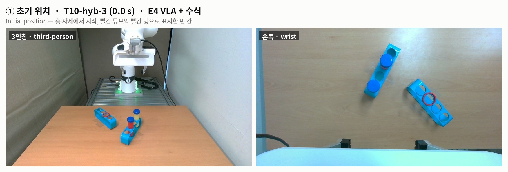

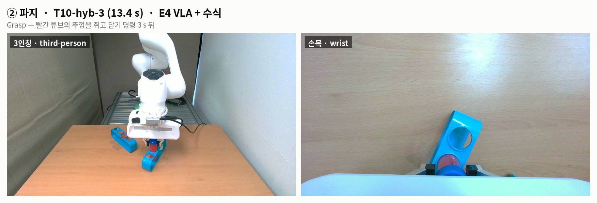

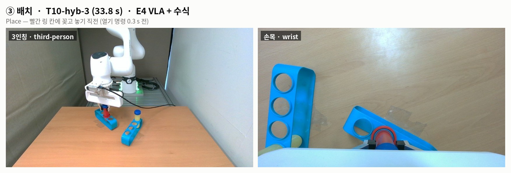

---

## 1. 요약

| 실험 | 학습 데이터 | 실행 | 판 수 | 성공 (Wilson 95%) | S9 꽂힘 |
|---|---|---|---|---|---|
| E1 | 실물 100판 | VLA만 | 20 | **1 (5%, 1–24%)** | 2 (10%) |
| E2 | 실물 200판 | VLA만 | 20 | **6 (30%, 15–52%)** | 6 (30%) |
| E3 | 실물 200판 + 시뮬 600판 | VLA만 | 18 (계획 30에서 중단) | **2 (11%, 3–33%)** | 2 (11%) |
| E4 | 실물 200판 (E2 모델) | VLA + 수식 | 30 | **16 (53%, 36–70%)** | 16 (53%) |

- E1 → E2 (데이터 100 → 200판)
  - 처음 보는 배치에서 빨간 튜브까지 손을 가져가 잡는 단계가 크게 좋아졌다.
    - S2 접근: 65% → 90%
    - S4 잡기: 30% → 75% (p = 0.01)
  - 최종 성공은 5% → 30% (p = 0.09).
- E3 (시뮬 600판 합침)
  - 성공 11%로 떨어져 18판에서 멈췄다.
  - **원인은 평가 배치를 E2 때와 똑같이 놓지 못한 것**이다(6.3절). 이 결과로는 시뮬 데이터의 효과를 판단할 수 없다.
- E4 (E2 모델 + 수식)
  - 성공 53%로, E2보다 23%p 높다.
  - 차이는 주로 마지막 꽂기에서 났다. 칸 위에 간 판 중 꽂힌 비율이 50% → 76%다.
  - 수식이 넘겨받은 동작은 잡기 20/20 쥠(들기까지 19/20), 꽂기 16/19 성공이었다.
  - 다만 E2보다 높다는 것은 통계적으로 확정되지 않는다(7.1절).
    - 최종 성공: p = 0.15 (배치별로 맞춘 검정 p = 0.10)
    - 같은 정의로 센 쥐기·들기·꽂기 비교도 E4가 높지만 p = 0.15–0.40이다.
    - E2와 날짜가 다르고 판 수가 작다.
- E4에서 남은 실패 14판:
  - VLA가 닫으려던 자리가 뚜껑에서 27–48 mm로, 수식이 넘겨받는 한도(25 mm) 밖: 6판. 수식은 목표를 바꾸지 않으므로 도울 수 없다.
  - 밝기 포화로 시작 장면 검출 실패: 2판
  - 꽂다가 걸림: 3판
  - VLA가 옆 칸으로 감: 2판
  - 들기 시작에 미끄러짐: 1판

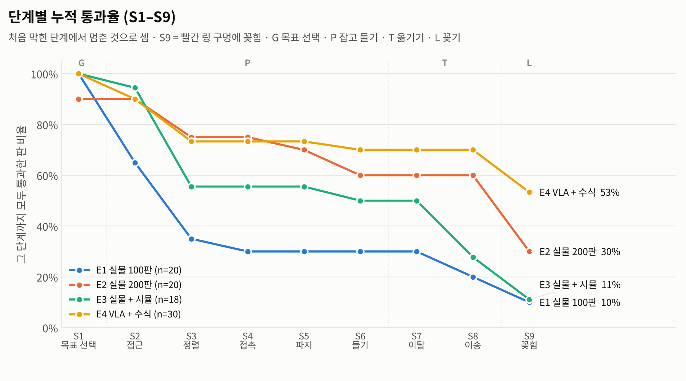

---

## 2. 실행 영상 — 실험마다 성공 판 하나

3배속 미리보기입니다. 판 이름을 누르면 실제 속도 영상(mp4, 3인칭 + 손목, 10 fps = 기록 주기)이 열립니다. E2·E3·E4는 같은 평가 배치 T06의 성공 판이고, E1은 유일한 성공 판(T07)입니다.

| E1 실물 100판 — [T07-v1-1](media/E1_T07-v1-1.mp4) (44.9 s) | E2 실물 200판 — [T06-v2-1](media/E2_T06-v2-1.mp4) (27.8 s) |
|---|---|
| 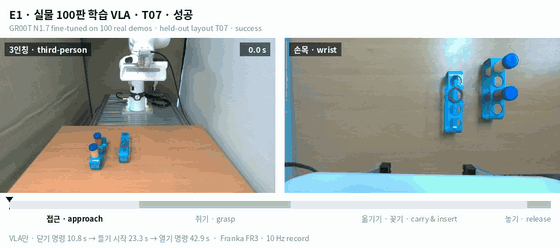 | 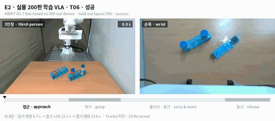 |
| **E3 실물 + 시뮬 — [T06-mix-3](media/E3_T06-mix-3.mp4) (29.6 s)** | **E4 VLA + 수식 — [T06-hyb-2](media/E4_T06-hyb-2.mp4) (37.4 s)** |
| 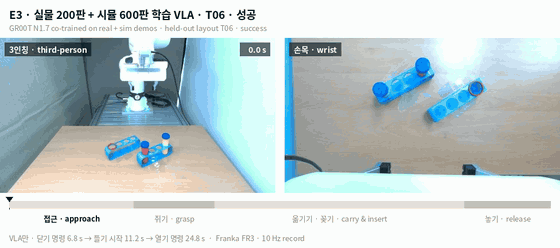 | 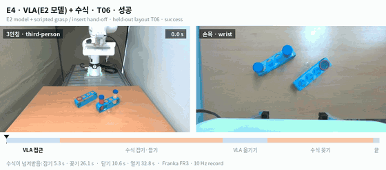 |

- 영상 아래 막대는 진행 단계입니다. VLA만 실행한 판(E1–E3)은 접근 · 쥐기 · 옮기기·꽂기 · 놓기로, E4는 그 순간 움직인 쪽(파랑 VLA · 주황 수식)으로 나눴습니다.
- E1 T07-v1-1은 옆 칸 쪽으로 내려가다가 다시 올라와 빨간 칸에 꽂았습니다(실험 메모). 닫기 명령 뒤 들기까지 12.5 s를 기다려 다른 판보다 깁니다.
- E4 T06-hyb-2는 수식이 5.3 s에 잡기를, 26.1 s에 꽂기를 넘겨받았습니다(5.5절 시간축). 조명 범위 밖 구간(10:56)에 돌린 판이라 화면이 밝습니다.

---

## 3. 실험 구성

| | E1 | E2 | E3 | E4 |
|---|---|---|---|---|
| 날짜 | 2026-11-05 | 2026-11-05 | 2026-11-11 | 2026-11-12 |
| 모델 | GR00T N1.7 미세조정 `v1_100ep_020000` | `v2_200ep_020000` | `v2sim50_020000` | `v2_200ep_020000` + 수식 |
| 학습 데이터 | 실물 자동 시연 100판 | 실물 자동 시연 200판 | 실물 200판 × 3 + 시뮬 600판 = 1,200판(실물 49%) | E2와 같음 (재학습 없음) |
| 학습 | 20,000 스텝 | 20,000 스텝 | 20,000 스텝 (E2와 같은 설정) | — |
| 평가 배치 · 판 수 | T01–T10 × 2 = 20 | T01–T10 × 2 = 20 | T01–T04 · T06 · T09 × 3 = 18 | T01–T10 × 3 = 30 |
| 무효 (제외) | 0 | 9 (배치·랙·튜브 놓기 실수, 모델 순서 실수, 컨트롤러 끊김 등) | 1 (랙 고정 실수) | 2 (배치 실수 1, 밝기 포화 1) |
| 순서 | 배치마다 E2 → E1 → E1 → E2 | (E1과 번갈아) | 배치마다 3판 연속 | 배치마다 3판 연속 |

- **공통:**
  - T01–T10은 수집에 쓰지 않은 배치다. 사람이 배치 그림을 보고 랙·튜브를 손으로 놓았다.
  - 성공은 빨간 튜브가 빨간 링 구멍에 꽂힌 것이고, 사람 판정이 최종이다.
  - 자동 판정이 틀린 판은 사람이 고쳤다(E4에서는 끝까지 꽂힌 튜브를 끝 장면이 못 찾아 '부분'이 뜬 10판).

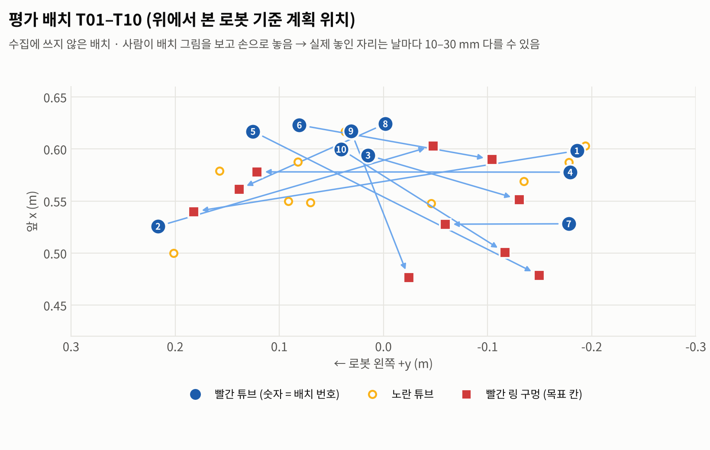

- **E4 동작 (스테이션 11-11k):** VLA가 움직이다가 다음 두 순간에만 수식이 넘겨받는다. 수식은 VLA가 고른 뚜껑·칸을 다른 것으로 바꾸지 않는다.
  1. VLA가 닫기를 예측한 자리가 시작 장면의 가장 가까운 뚜껑에서 25 mm 안일 때 → 수식 잡기
     - 두 번째로 가까운 뚜껑과 6 mm 이상 차이 나고, 그리퍼를 30° 넘게 돌리지 않아도 될 때만
     - 동작: 잡는 높이 + 5 cm에서 뚜껑 위로 옮김 → 수직 하강 → 정착 → 쥐기 → 처음 6 cm는 천천히, 모두 15 cm 들기
     - 잡는 높이: 보정 높이 평면 + 2.5 mm
     - 들기가 끝나면 다시 VLA
  2. 쥔 채 빨간 칸 25 mm 안으로 내려가려 할 때 → 수식 꽂기
     - 동작: 칸 위 6 cm 맞춤 → 수직 꽂기 → 놓기

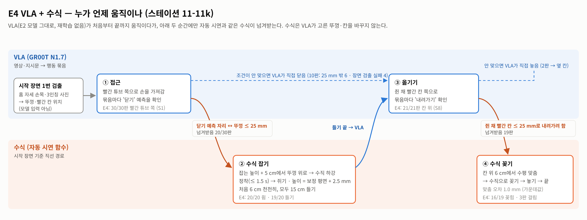

---

## 4. 평가 방법

### 4.1 단계 (평가표 S0–S9, FR3 기준값)

분류 연결: G = S1, P = S2–S6, T = S7–S8, L = S9. S0은 정책 실패와 따로 센다. 평가는 튜브가 빨간 링 구멍에 들어가는 순간(S9)까지 한다.

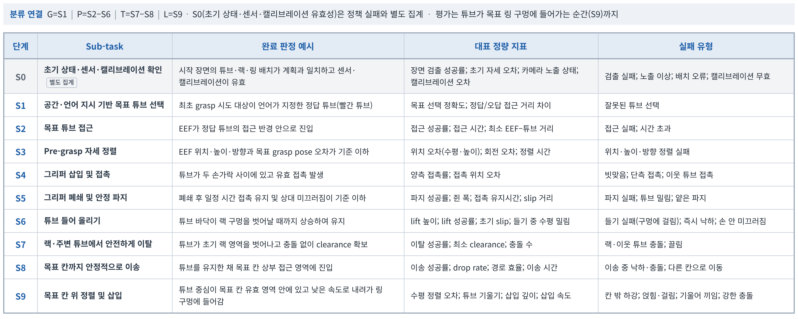

위 평가표는 FR3·FR5에 같이 쓰는 일반형입니다. 이 문서에서는 아래 FR3 기준값으로 판정했습니다.

| 단계 | 분류 | Sub-task | 이 문서의 판정 (FR3 기준값) |
|---|---|---|---|
| S0 | — | 초기 상태·센서·캘리브레이션 | 무효 판, 시작 장면 빨간 튜브 위치 검출, 첫 3인칭 화면 밝기(기준 132 + 15 이하)·포화(15% 미만) |
| S1 | G | 목표 튜브 선택 | 첫 쥐기 시도 대상이 빨간 튜브 (다른 튜브로 간 증거: 사진 검토, 수식 기록) |
| S2 | P | 목표 튜브 접근 | 손끝이 빨간 튜브 뚜껑 수평 25 mm 안·높이 170 mm 아래로 들어감 |
| S3 | P | Pre-grasp 자세 정렬 | 닫는 순간 손 앞뒤 −19 ~ +5 mm, 손가락 방향 ±24 mm, 높이 학습 109.6 ± 15 mm |
| S4 | P | 그리퍼 삽입·접촉 | 닫고 3 s 뒤 폭 20–50 mm (뚜껑에 닿아 멈춤) |
| S5 | P | 폐쇄·안정 파지 | 들기 시작까지 폭 12 mm 이상 유지 |
| S6 | P | 들어 올리기 | 쥔 채 60 mm 이상 (구멍 깊이 약 50 mm를 벗어남) |
| S7 | T | 랙·주변에서 이탈 | 쥔 채 60 mm 위·잡은 자리에서 수평 40 mm 밖 |
| S8 | T | 목표 칸까지 이송 | 쥔 채 빨간 칸 수평 20 mm 안 |
| S9 | L | 칸 위 정렬·삽입 | 빨간 링 구멍에 꽂힘 (사람 판정 성공 + 꽂았지만 안 놓은 판) |

### 4.2 채점 규칙

1. 판마다 처음 막힌 단계 하나를 정한다. 그 앞 단계는 통과, 뒤 단계는 '못 감'(실패)으로 센다. 표의 통과 수는 누적이다.
2. 뒤 단계를 통과했으면 앞 단계도 통과로 센다. 예를 들어 닫는 순간 잰 위치가 기준을 조금 넘어도 실제로 쥐었으면 S3를 통과로 본다.
3. 11-05 실패 33판은 사진·메모로 검토한 원인을 단계에 맞췄다.
   - 다른 튜브(G1) → S1
   - 잡기 위치(G2·G3·G5) → 잰 값으로 S2–S5
   - 들기(L) → S6
   - 칸 위(A) → S8
   - 꽂기(I) → S9
4. 시작 장면에 빨간 튜브 위치가 없고 잡기 전에 실패한 판은 사진으로 판단했다(E1 6, E2 1, E3 6, E4 2판). 빨간 튜브 근처에서 빈손이면 S3 실패로 셌다.
5. E1 T05-v1-1은 빨간 링 구멍에 꽂고 놓지 않아 실험자가 멈춘 판이다. 평가 범위가 꽂는 순간까지라 S9 통과로 셌다. 그래서 E1은 S9(2판)과 사람 판정 성공(1판)이 다르다.

---

## 5. 결과

### 5.1 단계별 누적 통과 (S0–S9)

| 단계 | E1 100판 | E2 200판 | E3 200판 + 시뮬 | E4 VLA + 수식 |
|---|---|---|---|---|
| S0 무효 판 | 0 | 9 | 1 | 2 |
| S0 시작 장면 튜브 위치 검출 | 14/20 | 14/20 | 8/18 | 26/30 |
| S0 조명 범위 밖 판 | 6/20 | 6/20 | **17/18** | 14/30 |
| S1 목표 튜브 선택 | 20/20 (100%) | 18/20 (90%) | 18/18 (100%) | 30/30 (100%) |
| S2 접근 | 13/20 (65%) | 18/20 (90%) | 17/18 (94%) | 27/30 (90%) |
| S3 정렬 | 7/20 (35%) | 15/20 (75%) | 10/18 (56%) | 22/30 (73%) |
| S4 접촉 | 6/20 (30%) | 15/20 (75%) | 10/18 (56%) | 22/30 (73%) |
| S5 안정 파지 | 6/20 (30%) | 14/20 (70%) | 10/18 (56%) | 22/30 (73%) |
| S6 들기 | 6/20 (30%) | 12/20 (60%) | 9/18 (50%) | 21/30 (70%) |
| S7 이탈 | 6/20 (30%) | 12/20 (60%) | 9/18 (50%) | 21/30 (70%) |
| S8 이송 | 4/20 (20%) | 12/20 (60%) | 5/18 (28%) | 21/30 (70%) |
| **S9 꽂힘** | **2/20 (10%)** | **6/20 (30%)** | **2/18 (11%)** | **16/30 (53%)** |
| 사람 판정 성공 | 1/20 (5%) | 6/20 (30%) | 2/18 (11%) | 16/30 (53%) |

단계 전환 (앞 단계를 통과한 판 중 이 단계를 통과한 비율):

| 단계 | E1 | E2 | E3 | E4 |
|---|---|---|---|---|
| S1 | 20/20 | 18/20 | 18/18 | 30/30 |
| S2 | 13/20 | 18/18 | 17/18 | 27/30 |
| S3 | 7/13 | 15/18 | 10/17 | 22/27 |
| S4 | 6/7 | 15/15 | 10/10 | 22/22 |
| S5 | 6/6 | 14/15 | 10/10 | 22/22 |
| S6 | 6/6 | 12/14 | 9/10 | 21/22 |
| S7 | 6/6 | 12/12 | 9/9 | 21/21 |
| S8 | 4/6 | 12/12 | 5/9 | 21/21 |
| S9 | 2/4 | 6/12 | 2/5 | **16/21** |

### 5.2 분류별 (G / P / T / L)

| 분류 | E1 | E2 | E3 | E4 |
|---|---|---|---|---|
| G 목표 선택 (S1) | 20/20 | 18/20 | 18/18 | 30/30 |
| P 잡고 들기 (S2–S6, G 통과 판 중) | 6/20 (30%) | 12/18 (67%) | 9/18 (50%) | 21/30 (70%) |
| T 옮기기 (S7–S8, P 통과 판 중) | 4/6 | 12/12 | 5/9 | 21/21 |
| L 꽂기 (S9, T 통과 판 중) | 2/4 | 6/12 (50%) | 2/5 | 16/21 (76%) |

### 5.3 처음 막힌 단계

| 처음 막힌 단계 | E1 | E2 | E3 | E4 |
|---|---|---|---|---|
| S1 다른 튜브 | 0 | 2 | 0 | 0 |
| S2 접근 못 함 | **7** | 0 | 1 | 3 |
| S3 정렬 어긋남 | **6** | 3 | **7** | 5 |
| S4 빈손 | 1 | 0 | 0 | 0 |
| S5 들기 전 빠짐 | 0 | 1 | 0 | 0 |
| S6 들기 실패 | 0 | 2 | 1 | 1 |
| S8 칸 위 못 감 | 2 | 0 | **4** | 0 |
| S9 꽂기 실패 | 2 | **6** | 3 | **5** |
| 통과 (꽂힘) | 2 | 6 | 2 | 16 |

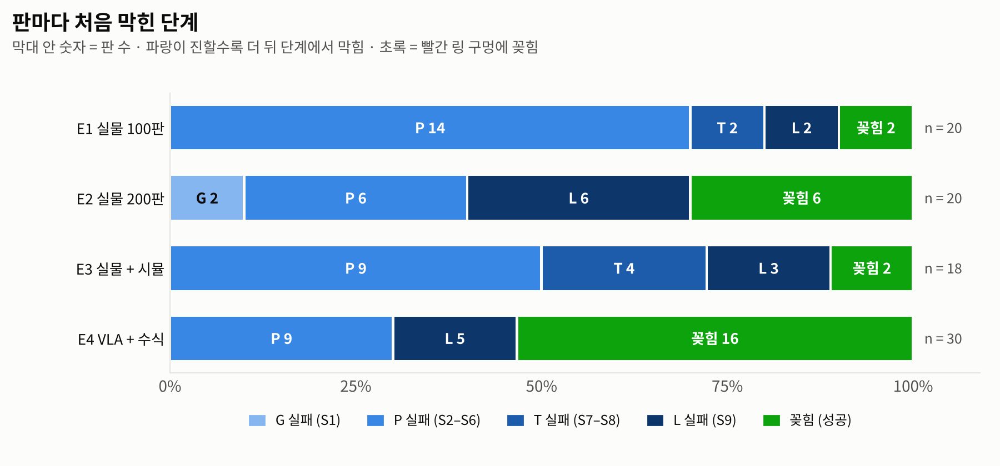

- 잡기 전(S1–S3) 실패: E1 13 · E2 5 · E3 8 · E4 8
- 잡기·들기(S4–S6) 실패: E1 1 · E2 3 · E3 1 · E4 1
- 옮기기(S7–S8) 실패: E1 2 · E2 0 · E3 4 · E4 0
- 꽂기(S9) 실패: E1 2 · E2 6 · E3 3 · E4 5

### 5.4 단계별 정량 지표 (가운데값, 괄호는 최소–최대)

| 단계 | 지표 | E1 | E2 | E3 | E4 |
|---|---|---|---|---|---|
| S2 | 접근 영역에 들어간 시각 (s, 시작부터) | 6.1 (4.6–7.5) | 4.7 (4.0–6.7) | 5.1 (4.7–6.2) | 4.5 (3.8–6.6) |
| S3 | 닫는 순간 \|손 앞뒤\| (mm) | 7.3 (0.3–15.4) | 3.9 (1.8–12.7) | 10.5 (0.4–19.1) | 0.7 (0.0–22.2) ¹ |
| S3 | 닫는 순간 \|손가락 방향\| (mm) | 17.6 (0.6–26.7) | 10.0 (0.3–22.2) | 4.2 (1.8–11.2) | 1.0 (0.1–19.4) ¹ |
| S3 | 닫는 높이 (mm, 학습 109.6) | 105.2 (94.9–126.6) | 108.0 (97.4–111.9) | 105.8 (102.1–114.0) | 103.9 (98.5–113.1) |
| S3 | 닫은 시각 (s) | 7.6 | 7.1 | 7.5 | 11.7 ² |
| S4 | 닫고 3 s 뒤 쥔 폭 (mm, 학습 32.9) | 29.9 (27.4–33.7) | 32.8 (30.8–35.8) | 32.5 (27.7–38.9) | 32.6 (31.6–33.1) |
| S6 | 60 mm 들 때까지 (s) | 13.9 (5.5–32.4) | 7.1 (6.0–9.8) | 8.0 (5.3–19.7) | 9.1 (5.8–9.7) |
| S6 | 들 때 옆 밀림 (mm, 60 mm까지) | 10.5 (2.2–17.8) | 4.2 (1.7–8.2) | 4.9 (2.7–8.3) | 5.1 (2.3–11.3) |
| S7 | 옆으로 움직이기 시작한 높이 (mm, 잡은 높이 위) | 58 (−1–131) | 130 (94–152) | 119 (98–145) | 136 (60–153) |
| S8 | 빨간 칸까지 가장 가까운 거리 (mm) | 11.2 ³ | 7.3 ³ | 18.4 ³ | 0.4 (0.1–6.3) ⁵ |
| S8 | 들기 → 칸 위 (s) | 4.6 | 5.7 | 5.5 | 5.5 |
| S8 | 옮기다 떨어뜨림 | 0 | 0 | 1 | 0 |
| S9 | 꽂기 멈춘 높이 − 학습 놓는 높이 (mm) | 사진 판정 ³ | 사진 판정 ³ | 사진 판정 ³ | 2.1 (−0.1–32.6) ⁴ |
| — | 성공 판 걸린 시간 (s) | 44.9 (1판) | 32.4 (27.8–32.9) | 28.4 (27.1–29.6) | 40.2 (32.8–45.2) |

¹ E4 닫기 27판 중 20판은 수식이 했다. 
² 수식 잡기의 이동(뚜껑 위로 옮기기·수직 하강)과 정착(최대 1.5 s) 시간이 들어 있다. 
³ E1–E3은 스테이션의 구멍 위치 추정값 기준이라 오차가 3–18 mm다. 그래서 꽂기는 사진·메모로 판정했다. 
⁴ 수식이 꽂은 19판 기준이다. 성공 판은 1.8 (−0.1–10.2), 걸린 3판은 +16.0 / +23.6 / +32.6. 
⁵ E4는 수식이 쓴 구멍 위치 추정값 기준이다. 수식이 이 값에 맞춰 내려가므로 실제 칸 중심까지의 거리는 아니다.

### 5.5 E4 수식 동작

| 항목 | 값 |
|---|---|
| 수식이 잡기를 넘겨받음 | 20/30 → **20판 모두 쥠**(S5 통과), 19판 들기 성공. 1판(T04-2)은 들기 시작에 빠짐(S6) |
| 넘겨받을 때 VLA가 닫으려던 자리 → 뚜껑 | 10.8 mm (3.8–21.0) |
| 잡기를 못 넘겨받은 10판 | VLA가 뚜껑 25 mm 밖(27–48 mm)에서 닫으려 함 6판(T05 × 3, T06-3, T07-1, T07-3) · 밝기 포화로 시작 장면에서 뚜껑을 못 찾음 4판(T08-2·3, T09-1·2) |
| 그 10판의 결과 | VLA가 직접 닫아 빈손 8판, VLA가 직접 쥔 2판(T08-3, T09-2)은 뒤에 수식 꽂기 |
| 수식이 꽂기를 넘겨받음 | 쥐고 든 21판 중 19 → **16 성공** |
| 넘겨받을 때 VLA 자리 → 빨간 칸 | 14.2 mm (4.4–23.6) |
| 칸 위 맞춤 오차 | 1.0 mm (0.4–1.9) |
| 꽂기를 못 넘겨받은 2판 | T04-1·3: VLA가 빨간 칸에서 29–30 mm 떨어진 곳(옆 칸)으로 내려감 → 부분 |

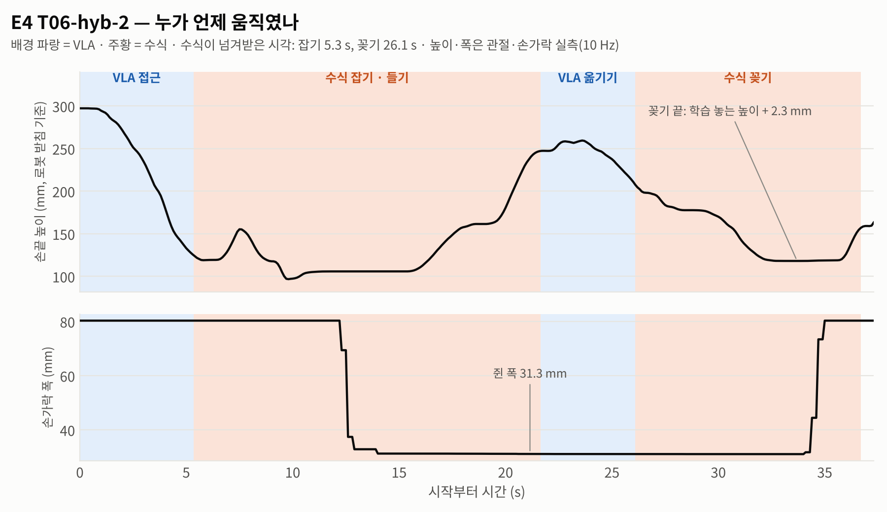

- 위 그림: E4 T06-hyb-2 판의 손끝 높이와 손가락 폭. 배경색이 그 순간 움직인 쪽입니다(파랑 VLA · 주황 수식).

### 5.6 배치별 성공

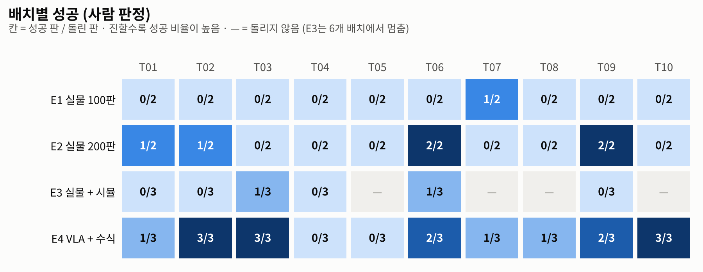

T04는 네 실험 모두, T05는 돌린 세 실험 모두 0판이다.

표로 보기

| 배치 | E1 | E2 | E3 | E4 |
|---|---|---|---|---|
| T01 | 0/2 | 1/2 | 0/3 | 1/3 |
| T02 | 0/2 | 1/2 | 0/3 | 3/3 |
| T03 | 0/2 | 0/2 | 1/3 | 3/3 |
| T04 | 0/2 | 0/2 | 0/3 | 0/3 |
| T05 | 0/2 | 0/2 | — | 0/3 |
| T06 | 0/2 | 2/2 | 1/3 | 2/3 |
| T07 | 1/2 | 0/2 | — | 1/3 |
| T08 | 0/2 | 0/2 | — | 1/3 |
| T09 | 0/2 | 2/2 | 0/3 | 2/3 |
| T10 | 0/2 | 0/2 | — | 3/3 |

---

## 6. 실험별 분석

### 6.1 E1 — 실물 100판

- 성공 1/20 (5%). 꽂힘(S9)은 2/20이다.
- **가장 약한 곳은 접근(S2)과 정렬(S3)이다.** 잡기 전 단계에서 13판이 막혔다.
  - 7판은 빨간 튜브 25 mm 안으로 오지 못했다. 랙 안의 다른 자리에서 닫았는데, 빨간 튜브에서 손가락 방향으로 22–63 mm 떨어진 곳이었다(구멍 간격 37.2 mm의 0.6–1.7배).
  - 그중 5판은 손가락이 뚜껑 위에 얹혔다. 실제 손이 명령보다 5–8 mm 위에 있었다.
  - 6판은 시작 장면에 튜브 위치가 없어 사진으로 판단했다(빨간 튜브 근처에서 빈손).
- 쥔 6판은 모두 들었다. 다만 들기가 느리고(60 mm까지 13.9 s) 들 때 옆 밀림이 10.5 mm로 컸다. 칸 위 4/6, 꽂힘 2/4.

### 6.2 E2 — 실물 200판

- 성공 6/20 (30%).
- **데이터를 늘린 효과는 잡기 전 단계에 집중됐다.**
  - S2 접근: 65% → 90%
  - S4 잡기: 30% → 75% (p = 0.01)
  - 잡기 전 실패: 13판 → 5판. 노란 튜브 2판, 손 앞쪽으로 8–9 mm 어긋남 2판, 사진 판단 1판.
  - 닫는 순간 \|손가락 방향\|: 17.6 → 10.0 mm
- **남은 병목은 꽂기(S9)다.** 칸 위에 간 12판 중 6판만 꽂혔다.
  - 옆 칸에 꽂음 2판(I3)
  - 랙에 걸려 덜 꽂힘 4판
    - 옆으로 19 mm 어긋남 1판(I1)
    - 튜브 바닥이 랙 윗면에 얹힘 1판(I2)
    - 놓는 높이 + 15 mm에서 막힘 2판(T04, I1·I2 구분 못 함)
- 쥔 뒤 실패 3판:
  - 들기 전 미끄러짐 1판
  - 들기 시작에 미끄러짐 1판
  - 정책이 들지 않고 그리퍼를 엶 1판
- 성공 판은 28–33 s 걸렸다.

### 6.3 E3 — 실물 200판 + 시뮬 600판 (중단)

- 성공 2/18 (11%). 12판 뒤 미리 정한 기준(30판 중 18판)을 넘기 어려워져, 18판(6개 배치 × 3)에서 멈췄다.
- 단계별로 보면:
  - 잡기 전 실패 8판
    - 빨간 튜브 근처에서 빈손 7판: 같은 배치에서 쥔 판보다 5–10 mm 앞에서 닫았다.
    - 빨간 튜브 25 mm 안으로 못 감 1판
  - 칸 위 못 감 4판: 빨간 칸에서 22–32 mm, 1판은 옮기다 떨어뜨림. 이 거리는 구멍 위치 추정값 기준이라(오차 3–18 mm, 이날은 조명 탓에 더 클 수 있음) S8·S9 구분은 몇 판 바뀔 수 있다.
  - 꽂기 실패 3판
- **원인: 평가 배치를 E2 때와 똑같이 놓지 못했다.**
  - 같은 배치 이름이라도 랙이 11-05와 10–30 mm, 최대 7° 다르게 놓였다.
  - 이 차이가 정책의 위치 정밀도(약 1 cm)와 잡기 앞뒤 허용 폭(약 2.4 cm, −19 ~ +5 mm)을 넘었다.
  - 다른 원인이 아니라는 근거 두 가지:
    1. 같은 관측을 두 모델에 넣으면 닫는 자리는 2.0 mm, 놓는 자리는 4.3 mm밖에 다르지 않았다. 시뮬 데이터가 행동을 거의 바꾸지 않았다는 뜻이다.
    2. 이날 화면이 밝았지만(S0 조명 범위 밖 17/18판), 밝기·색을 학습 때처럼 바꿔 넣어도 향하는 자리가 1.3 mm만 움직였다.
- 그래서 이 18판으로는 시뮬 데이터의 효과를 판단할 수 없다.
- 이 원인은 배치 차이를 잰 값과 다른 후보를 뺀 결과로 판단한 것이다. 랙을 일부러 옮겨 보는 통제 실험은 하지 않았다.

### 6.4 E4 — VLA + 수식

- 성공 16/30 (53%).
- **G (S1) 30/30.** VLA는 모든 판에서 빨간 튜브 쪽으로 갔다.
- **P (S2–S6) 21/30.**
  - 수식이 넘겨받은 잡기 20판은 모두 뚜껑을 쥐었고, 19판은 들기까지 성공했다.
  - 실패 9판 중 8판은 수식이 넘겨받기 전에 막혔다.
    - VLA가 닫으려던 자리가 뚜껑에서 27–48 mm로 넘겨받는 한도(25 mm) 밖인 판: 6판
      - S2 실패 3판(T05 전부): 손끝이 빨간 튜브 뚜껑에 39–76 mm까지밖에 오지 못했다.
      - S3 실패 3판(T06-3, T07-1, T07-3): 실제로는 뚜껑에서 17–25 mm 거리에서 닫았다. 하지만 넘겨받을지 판단할 때 VLA가 예측한 닫기 자리가 27–33 mm여서 수식이 넘겨받지 않았다. 손 앞뒤 +10–22 mm로 빈손이었다.
    - 시작 장면 검출 실패로 수식을 쓰지 못하고 VLA가 직접 닫아 빈손이 된 판: 2판
  - 나머지 1판(T04-2)은 수식 잡기 뒤 들기 시작에 손가락에서 빠졌다. 그 뒤에도 수식 들기와 VLA가 빈손으로 이어 갔다.
- **T (S7–S8) 21/21.** 옮기다 떨어뜨린 판이 없다. 수식 꽂기의 칸 위 맞춤 오차는 가운데값 1.0 mm(0.4–1.9)다.
- **L (S9) 16/21 (76%).**
  - 수식 꽂기는 19판 중 16판 성공. 성공 판은 학습 놓는 높이 + 1.8 mm(가운데값)까지 내려갔다.
  - 걸린 3판(T01-2·3, T08-3)은 놓는 높이 + 16–33 mm에서 멈췄다(덜 꽂힘).
    - T01은 3판 모두 수식이 거의 같은 칸 위치(서로 1.4 mm 안)에 맞춤 오차 1.3 mm 안으로 맞췄는데, 1판만 꽂혔다. 그래서 칸 위치보다 쥔 튜브의 자세(기울기·치우침)가 원인으로 보인다. 사진으로 기울기를 확인하지는 못했다.
    - T01-3은 쥔 폭이 28.4 mm로 수식 잡기 20판 중 가장 좁았다. 끝 장면에서는 튜브가 빨간 링과 함께 랙 밖 책상에 떨어져 있었다.
    - T08-3은 VLA가 직접 쥔 튜브였다.
  - VLA가 옆 칸으로 내려간 2판(T04)은 넘겨받는 한도(25 mm) 밖이라 수식이 손대지 않았다.
- **S0 조명:**
  - 10:50–11:11 사이 14판이 조명 범위 밖이었다(밝기 기준 + 15 넘음 또는 포화 15% 이상).
  - 성공은 범위 밖 5/14, 범위 안 11/16이었다(p = 0.14). 범위 밖 구간이 T05–T09와 겹쳐 배치 탓과 나눌 수 없다.
  - 이 구간의 4판은 시작 장면에서 뚜껑을 못 찾아 수식 잡기를 쓸 수 없었다.
  - 실험자가 포화가 올라간 판을 무효로 하고 쉬었다가 밝기가 돌아온 뒤(14:19) 이어서 돌렸고, 그 4판(T09-3, T10 × 3)은 모두 성공했다.

  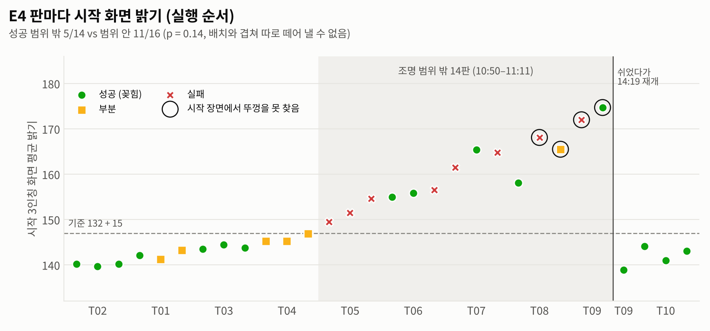
- 성공 판 시간은 가운데값 40.2 s로 E2(32.4 s)보다 약 8 s 길다. 수식의 수직 접근·정착·천천히 들기·칸 위 맞춤이 들어가기 때문이다.

---

## 7. 실험 간 비교

| 비교 | 최종 성공 | Fisher p | 단계에서 달라진 곳 |
|---|---|---|---|
| E1 → E2 (데이터 100 → 200판, 같은 날 번갈아) | 5% → 30% | 0.09 | S2 65 → 90%, S4 30 → 75% (p = 0.01), 잡기 전 실패 13 → 5판 |
| E2 → E3 (시뮬 합침) | 30% → 11% | 0.24 | 날짜·배치 조건이 달라 비교에 쓰지 않음 (6.3절) |
| E2 → E4 (수식 추가, 같은 모델) | 30% → 53% | 0.15 | S9 전환 50 → 76% (6/12 → 16/21, p = 0.15), S8 60 → 70% |
| E3 → E4 | 11% → 53% | 0.005 | 날짜가 다름 (참고) |

- 데이터를 늘리면(E1 → E2) VLA가 처음 보는 배치에서 빨간 튜브까지 손을 가져가는 능력(S2·S3)이 좋아졌다.
- 수식을 붙이면(E2 → E4) VLA가 가까이 데려온 판의 마지막 mm 단위 동작(쥐기·꽂기)에서 성공률이 높았다.
  - 수식이 맡은 잡기: 20/20 쥠 (들기까지 19/20)
  - 수식이 맡은 꽂기: 16/19
  - 같은 정의로 E2와 비교하면 쥐기 75 → 87%, 꽂기 50 → 76%다. 다만 통계적으로 확정되지는 않는다(7.1절).
- 잡기 누적 통과(S4)는 E4 73%로 E2 75%보다 높지 않았다. 수식은 VLA가 고른 목표 근처(25 mm 안)에서만 동작하므로, VLA가 멀리 간 판(E4 6판)은 그대로 실패했다.

### 7.1 E2 → E4 차이의 강도

두 실험을 같은 정의로 센 비교다. E4 분모에는 수식이 넘겨받지 못한 판도 들어간다.

| 비교 | E2 (VLA만) | E4 (VLA + 수식) | Fisher p |
|---|---|---|---|
| 최종 성공 | 6/20 (30%) | 16/30 (53%) | 0.15 |
| 최종 성공, 배치별로 맞춘 정확 검정 | — | — | 0.10 (한쪽 0.06) |
| 손이 빨간 튜브 뚜껑 25 mm 안에서 닫힘 → 쥠 (S5) | 9/12 (75%) | 20/23 (87%) | 0.39 |
| 같은 판 → 60 mm 들기 (S6) | 8/12 (67%) | 19/23 (83%) | 0.40 |
| 쥔 채 칸 위(20 mm 안)에 감 → 꽂힘 (S9) | 6/12 (50%) | 16/21 (76%) | 0.15 |

- E4의 23판은 수식 잡기 20판에, VLA가 직접 17–25 mm에서 닫아 빈손이 된 3판(T06-3, T07-1, T07-3)을 더한 것이다.
- E4의 21판은 수식 꽂기 19판에, VLA가 옆 칸으로 내려간 2판(T04-1·3)을 더한 것이다.
- 수식이 넘겨받은 판만 세면 잡기 20/20, 꽂기 16/19라 차이가 더 커 보인다. 하지만 수식이 넘겨받지 못한 실패 판이 분모에서 빠지므로 E2와 비교하는 값으로 쓰지 않는다.
- 최종 성공 차이(23%p)를 5% 수준에서 확인하려면 조건마다 약 80판이 필요하다(30% → 53% 가정, 검정력 80%). 조건마다 40판이면 검정력이 약 47%, 60판이면 약 65%다.
- 모든 비교는 날짜가 다르다(E2 11-05, E4 11-12). E3에서 확인했듯 날마다 배치가 10–30 mm 달라지므로, 그 차이가 섞여 있을 수 있다.
- 그래서 이 문서는 E4의 결과를 다음 두 가지로 적는다.
  - 수식이 맡은 동작의 성공률(잡기 20/20, 꽂기 16/19)
  - 잡기 전 단계(S2–S4)는 E2와 비슷하고(S4 75% vs 73%) 쥔 뒤 단계부터 높아져, 최종 30% → 53%가 되었다는 관찰값(통계적으로는 확정 아님)

### 7.2 남은 과제

- 실패 구조로 보면 남은 과제는 세 가지다.
  - VLA 쪽: 목표 근처까지 오는 위치 정밀도 (E4 접근·정렬 실패 6판, T05)
  - 넘겨받는 판단: VLA가 예측한 닫기 자리로 판단하는데, 실제로는 뚜껑 17–25 mm에서 닫은 3판(T06-3, T07-1·3)을 놓쳤다. 넘겨받는 반경·시점을 조정할 후보다. 단, 수식이 VLA의 목표를 바꾸지 않는다는 원칙은 지켜야 한다.
  - 수식 쪽: 쥔 튜브의 자세(기울기·치우침)를 확인하고 꽂기 (E4 꽂기 걸림 3판), 들기 시작 미끄러짐 (1판)

---

## 8. 한계

- 판 수가 작다(20 / 20 / 18 / 30). E4와 E2의 차이는 최종 성공(p = 0.15)과 단계별 비교(p = 0.15–0.40) 모두 5% 수준에서 유의하지 않다(7.1절).
- 같은 날 같은 배치에서 번갈아 돌린 비교는 E1 대 E2뿐이다. E3·E4는 다른 날 손으로 다시 놓은 배치라, 날마다 놓인 자리가 조금씩 다르다(E3에서 10–30 mm 확인).
- E4 30판 중 14판은 조명 범위 밖에서 돌았다.
- 11-05 실패는 사진·메모로 검토했고, 11-11·11-12는 수치로 판정했다. 튜브 위치 기록이 없고 잡기 전에 실패한 15판은 사진으로 단계를 정했다.
- 옆 칸으로 간 판은 11-05 검토 분류를 그대로 따랐다. 그래서 E1 2판(A1)은 S8, E2 2판(I3)은 S9로 셌다.
- 스테이션의 구멍 위치 추정값은 성공 판의 실제 놓은 자리와 3–18 mm 차이 났다(E1–E3). 그래서 E1·E2의 S8·S9는 사진·메모·사람 판정에 기댄다. E3의 S8은 추정값으로 판정해 S8·S9 구분이 몇 판 바뀔 수 있다.
- 학습 때 본 배치에서의 성능은 재지 않았다.
- FR3 기준값(25 mm, −19 ~ +5 mm, 60 mm 등)은 이 장비·튜브 기준이다. FR5는 같은 단계에 자기 기준값을 쓴다.

---

## 9. 파일

| 경로 | 내용 |
|---|---|
| `README.md` | 이 문서 |
| `appendix_runs.md` | 부록 A — 88판 판별 채점 (처음 막힌 단계 · 누가 잡고 꽂았는지 · 내용) |
| `data/stage_runs.csv` | 판별 채점표 (88판): 실험 · 배치 · 사람/자동 판정 · 처음 막힌 단계 · S1–S9 통과 · 닫는 순간 위치 · 쥔 폭 · 들어 올린 높이 · 수식 넘김 · 시작 화면 밝기 |
| `data/stage_runs.json` | 채점 스크립트 원출력 (무효 판 포함 100판, 판별 지표 전부) |
| `data/stage_summary.json` | 실험별 요약 (누적 통과 · 처음 막힌 단계 · 단계별 지표 · E4 수식 동작) |
| `data/fail_causes_T_1105_review.csv` | 11-05 실패 33판 사진·메모 검토 결과 (E1·E2 채점에 씀) |
| `data/layouts_T.csv` | 평가 배치 T01–T10 계획 위치 (두 랙 · 빨강 · 노랑 · 링 칸) |
| `data/media/timeline/*.csv`, `data/media/picked.json` | 영상·사진 판 5개의 10 Hz 시계열 (시각 · 손끝 xyz · 손가락 폭 · 그리퍼 명령)과 사진 순간 · 수식 기록 |
| `figs/task_{1_start,2_grasp,3_place}.jpg` | 초기 위치 · 파지 · 배치 사진 (3인칭 · 손목) |
| `figs/eval_table_S0S9.png` | 단계 평가표 (일반형) |
| `figs/fig_stage_cumulative.png` | 단계별 누적 통과율 |
| `figs/fig_first_fail.png` | 판마다 처음 막힌 단계 |
| `figs/fig_layout_success.png` | 배치별 성공 |
| `figs/fig_layouts_T01_T10.png` | 평가 배치 위치 |
| `figs/fig_e4_flow.png` | E4 VLA + 수식 동작 (누가 언제 움직이나) |
| `figs/fig_e4_timeline.png` | E4 판 하나의 손끝 높이 · 손가락 폭 시간축 |
| `figs/fig_e4_lighting.png` | E4 판마다 시작 화면 밝기 |
| `media/E{1,2,3,4}_*.mp4` | 실험별 성공 판 실행 영상 (실제 속도) |
| `media/E{1,2,3,4}_*_x3.gif` | README용 3배속 미리보기 |
| `scripts/eval_deep_1112.py` | 평가 기록에서 채점 재료 모으기 (로봇 PC, 읽기만) |
| `scripts/score_stages.py` | deep.json → 판별 단계 채점 (`data/stage_runs.json`) |
| `scripts/summarize.py` | 실험별 요약 (`data/stage_summary.json`) |
| `scripts/fig_eval_1112.py` | 도표 5개 |
| `scripts/media_export_1112.py` | 영상·사진 재료 모으기 (로봇 PC, 읽기만) |
| `scripts/video_4exp.py`, `scripts/fig_task_photos.py`, `scripts/fig_e4_timeline.py` | 실행 영상, 과제 사진, E4 시간축 |

[부록 A — 판별 채점 (88판)](appendix_runs.md)
