# 실물 평가 결과 — GR00T N1.7로 빨간 튜브를 빨간 칸에 꽂기 (Franka FR3)

> [!NOTE]
> **그 뒤 결과** — 이 문서는 첫 평가(2026-11-02, v1, 40회)입니다. 그 뒤의 평가는 폴더마다 README가 있습니다.
>
> - **[실물 평가 3 — 실험 4개를 단계 평가 S0–S9로 비교 (11-05 ~ 11-12)](../FR3_results_4exp_S0S9/)**: 처음 보는 배치 T01–T10에서 실물 100판 **1/20 (5%)** · 실물 200판 **6/20 (30%)** · 실물 200판 + 시뮬 600판 **2/18 (11%, 중단)** · VLA + 수식 **16/30 (53%)**
> - **[실물 평가 2 — 200판 모델 v2와 100판 모델 v1 비교 (11-05)](../FR3_results/)**: 같은 날 같은 배치에서 v1 **1/20 (5%)** → v2 **6/20 (30%)**, 실패 원인 분석. 평가 3의 실물 100판·200판이 이 판들입니다.

> - **방법:** 자동 시연 데이터 생성 → LeRobot 변환 → GR00T N1.7 미세조정 → 폐루프 실행은 방법 저장소 **[BioRoboticsRealFranka](https://github.com/SungjinDavidLee/BioRoboticsRealFranka)** 에 있습니다. 이 폴더는 **실물 평가 결과와 실패 분석**만 다룹니다.
> - **파일 위치:** 이 평가의 그림·사진·데이터·스크립트는 모두 [`results/`](results/) 아래에 있습니다(8절).
> - **평가:** 2026-11-02 · 체크포인트 20k · 지시문 "put the red tube in the red slot" · 총 40회 (배치 14개)

**English summary.** On the real FR3, the policy succeeded in **17/40 trials (42.5%, Wilson 95% CI 29–58%)** over 14 table layouts. Splitting layouts by whether the training data contained a nearby configuration (a training episode within 35 mm in tube + hole position) gives:

- **in-distribution: 13/16 (81%, 57–93%)**
- **out-of-distribution: 4/24 (17%, 7–36%)**
- Spearman ρ = −0.84 over the 14 layouts

The 23 non-successes split into six types:

- went to the other tube (6)
- missed the red tube by about 1 cm (3)
- station gripper timeout (2)
- went to the neighbouring hole (3)
- blocked right above the hole (8)
- released high beside the hole (1)

The main limitation is the diversity of rack arrangements in the 100 training episodes (about 30 distinct arrangements), not the number of episodes. The first 30 trials followed a fixed plan (10 layouts × 3). The last 10 recreated training-data layouts by eye (the experimenter looked at the collected episodes and rebuilt them as closely as possible). By the 35 mm measure, 2 of these 4 layouts still fell outside the training distribution. The split rule was set after the first 30 trials (section 2).

---

## 1. 한눈에 보기

| 구분 | 배치 | 성공 | Wilson 95% | 배치 단위 부트스트랩 95% |
|---|---|---|---|---|
| **분포 안** | 1·2·6·10·11·14 (6개) | **13/16 = 81%** | 57–93% | 57–100% |
| **분포 밖** | 3·4·5·7·8·9·12·13 (8개) | **4/24 = 17%** | 7–36% | 0–42% |
| **전체** | 14개 | **17/40 = 42.5%** | 29–58% | 21–65% |

*분포 안 = 학습 100판 중 빨간 튜브 위치와 빨간 링 구멍 위치가 함께 가까운(√(Δ튜브² + Δ구멍²) ≤ 35 mm) 판이 있는 배치.*

| 항목 | 결과 |
|---|---|
| 처음 30회 / 추가 10회 | 11/30 (37%, 22–54%) / 6/10 (60%, 31–83%) |
| 단계별 | 잡기 31/40 (78%) → 들기 29/40 (72%) → 꽂고 놓기 17/40 (42.5%) · 들어 올린 뒤 꽂기 17/29 (59%) |
| 같은 배치 반복 (예비) | **8/8** — 닫은 자리 흩어짐 4.2 mm, 튜브와 어긋남 중간 3.3 mm |
| 성공한 판 시간 | 중간 28.9 s (26.9–38.2 s) · 서버 왕복 지연 중간 147 ms |
| 자동 판정 vs 사람 판정 | 34/40 일치 · 고친 6회(2-1, 5-2, 5-3, 10-3, 11-1, 14-1)는 모두 부분 → 성공 (자동 판정이 성공을 부풀린 적 없음) |
| 무효 (통계 제외) | 3회 — 17:00, 17:10, 18:46(배치 12, 랙을 제대로 고정하지 않은 준비 실수로 랙이 들림) |

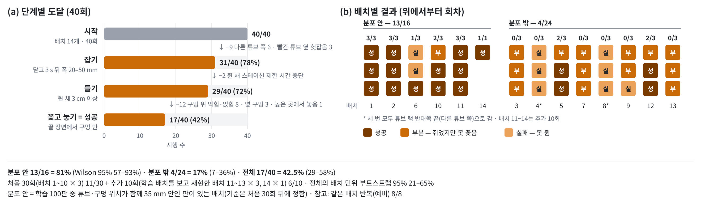

## 2. 평가 조건과 진행 순서

| 항목 | 값 |
|---|---|
| 정책 | GR00T N1.7 부분 미세조정, 자동 시연 100판(학습에 모두 사용), 체크포인트 20k |
| 실행 | 원격 GPU 추론 · 행동 16칸 중 8칸씩, 움직이면서 다음 묶음 요청(연속 실행) · 최대 120 s |
| 판정 | 성공 = 빨간 튜브를 빨간 링 구멍에 꽂고 놓음(시간 안에 다시 시도해 성공해도 성공) · 부분 = 쥐었지만 못 꽂음 · 실패 = 못 쥠 |
| 무효 | 정책과 무관한 중단·준비 실수만. 사람 판정이 최종 |
| 안전장치 | 작업 범위, 기울기 25°, 0.1 s당 5 cm, 역기구학, 관절 한계 — 위험할 때만 그 자리 정지 |

진행 순서(실행 기록의 시각 기준):

1. **예비:** 한 배치를 8회 반복해 모두 성공했습니다. 한 장면의 반복만으로는 성능을 과대평가한다고 보고 평가 방식을 바꿨습니다. 앞 3회는 배치 1로 쓰고, 나머지 5회는 반복 정밀도 비교에만 썼습니다.
2. **처음 30회 (16:03–17:19):** 배치 10개 × 3회. 배치는 그때그때 정하고, 3회 동안은 튜브만 제자리로 되돌렸습니다.
3. **추가 10회 (18:40–19:07):** 배치 11·12·13 × 3회, 배치 14 × 1회.
   - 실험자가 수집한 학습 데이터의 배치 사진을 보고 최대한 비슷하게 재현한 배치입니다(학습 배치 재현).
   - 평가 기준 문서에는 실행 전에 "무작위로 정한 배치 10개 × 1회"로 적어 두었지만, 실제로는 이 재현 방식으로 진행했습니다.
   - 눈으로 재현한 것이라 실제 위치는 학습 판과 차이가 났습니다. 배치 11·14는 가장 가까운 학습 판과 16·18 mm로 분포 안이었고, 배치 12·13은 튜브 위치가 31–34 mm 달라 40·47 mm로 기준(35 mm)상 분포 밖이었습니다.
   - 배치 14의 1회는 메모가 "13-3"으로 적혀 있었습니다. 튜브·구멍 위치가 배치 13과 9·14 cm 달라 별도 배치로 셌습니다(배치 11과 비슷한 배치).
4. **분포 안·밖 기준 (19:05):** 처음 30회의 결과를 본 뒤 정했습니다. 그래서 배치 1~13은 기준을 정하기 전에, 배치 14는 그 후에 실행했습니다. 기준은 결과와 상관없이 모든 배치에 같게 적용했고(`scripts/eval_report.py`가 시작 장면으로 자동 계산), 분포 안·밖 성공률은 사후 하위분석으로 읽어야 합니다.

추가 10회는 학습 배치를 재현하려고 한 것이라 처음 30회보다 학습 데이터에 가까운 쪽으로 치우쳐 있습니다. 그래서 전체 성공률(42.5%)은 배치를 어떻게 섞었는지에 따라 달라지고, 정책의 성질은 분포 안·밖으로 나눈 숫자가 더 잘 보여 줍니다.

## 3. 실패 원인 (성공 못 한 23회)

| 유형 | 횟수 | 시행 | 기록으로 본 근거 |
|---|---|---|---|
| **A. 다른 튜브 쪽으로 감** | 6 | 4-1·2·3, 8-1·2·3 | 빨간 튜브에서 12–14 cm 떨어진 튜브 랙 반대쪽 끝(다른 튜브 쪽)에서 닫음. 같은 배치 3회의 흩어짐 4–7 mm로 매번 같은 곳을 고름 |
| **B. 빨간 튜브 옆에서 헛잡음** | 3 | 6-1, 6-2, 9-3 | 빨간 튜브에서 9–12 mm 옆, 학습 때보다 7–15 mm 높은 곳에서 닫음. 6-2는 이어서 다음 행동이 0.1 s에 5.6 cm라 안전장치가 멈춤 |
| **C. 쥔 채 스테이션 제한 시간 중단** | 2 | 5-1, 7-1 | 튜브를 쥐었는데(폭 27 mm) 그리퍼 동작이 4 s 안에 끝나지 않아 스테이션이 중단. **정책 실패가 아님**(규칙대로 부분) |
| **D. 옆 구멍 쪽으로 감** | 3 | 3-3, 7-2, 9-2 | 쥔 채 가장 가까이 간 자리가 랙 방향으로 20·23·31 mm. 9-2의 31 mm는 구멍 간격(32 mm)과 같아 바로 옆 구멍 |
| **E. 구멍 위까지 갔지만 못 들어감** | 8 | 3-1, 3-2, 7-3, 9-1, 10-1, 12-1, 13-1, 13-3 | 구멍 1–13 mm 안까지 갔지만 학습 때 놓은 높이보다 2–47 mm 위에서 멈춤. 실제 손끝이 명령보다 12–34 mm 위에 머묾(테두리에 막힘). 3-2는 9번 누르다 빨간 링이 랙에서 밀려 떨어짐. 13-1은 47 mm 위에서 막힌 뒤 다음 행동이 0.1 s에 6.2 cm라 안전장치 중단 |
| **F. 구멍 옆 높은 곳에서 놓음** | 1 | 13-2 | 구멍 12 mm 안까지 간 뒤, 학습 놓은 높이보다 65 mm 위·구멍에서 38 mm 떨어진 곳에서 그리퍼를 엶 |

- 잡기 단계 실패는 11회(A 6 · B 3 · C 2), 꽂기 단계 실패는 12회(D 3 · E 8 · F 1)입니다.
- 스테이션 문제(C)를 빼면 성공률은 17/38 = 45%입니다.
- 분포 안 배치의 실패는 3회(6-1, 6-2, 10-1)뿐이고, 나머지 20회는 분포 밖 배치에서 나왔습니다.
- 꽂기 위치의 기준점(시작 장면의 빨간 링 → 보정 → 구멍 위치)에는 오차가 있습니다. 성공한 판에서 놓은 자리와 기준점의 차이는 중간 8 mm, 최대 17 mm였습니다. 그래서 E 유형은 "자리가 틀렸다"기보다 "구멍과 튜브가 거의 딱 맞아 수 mm 어긋나거나 기울면 막힌다"로 해석합니다. D 유형(20–31 mm)은 이 오차보다 확실히 큽니다.

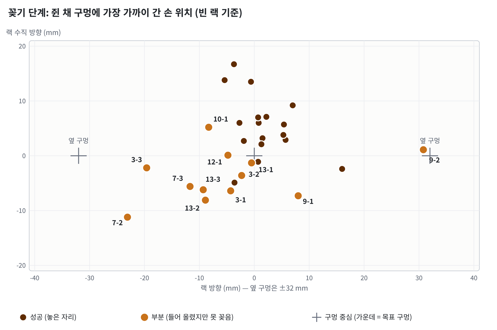

*그림: 쥔 채 구멍에 가장 가까이 간 손 위치(빈 랙 기준). 진한 점은 성공한 판의 놓은 자리, 주황 점은 들어 올렸지만 못 꽂은 판. 랙 방향 ±32 mm가 옆 구멍.*

### 유형별 대표 사진

각 사진은 6칸입니다: ① 시작 3인칭 ② 시작 손목(장면 찾기 표시) ③ 그리퍼가 닫히는 순간 ④ 닫고 3초 뒤 ⑤ 놓는 순간 또는 구멍에 가장 가까운 순간 ⑥ 끝 장면.

**성공 — 1-3.** 한 번에 꽂음(닫은 자리 3 mm · 놓은 자리 6 mm).

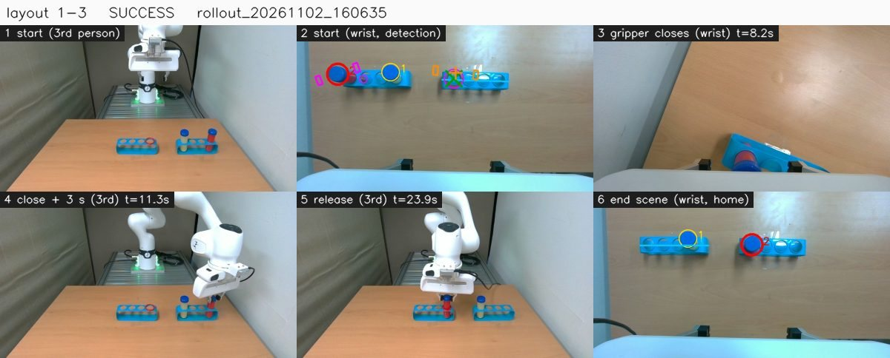

**A. 다른 튜브 쪽으로 감 — 8-1.** 빨간 튜브에서 약 14 cm 왼쪽, 노란 튜브 너머에서 닫음.

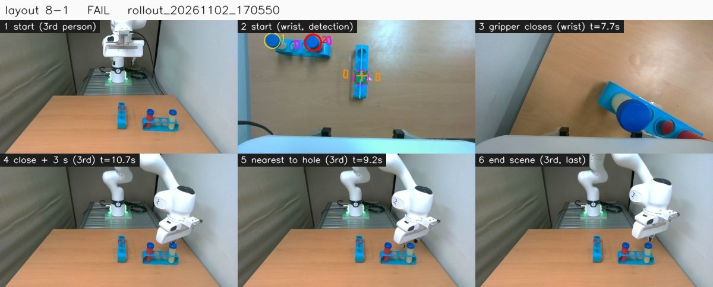

**B. 빨간 튜브 옆에서 헛잡음 — 6-1.** 빨간 튜브 9 mm 옆, 학습보다 7 mm 높은 곳에서 닫음.

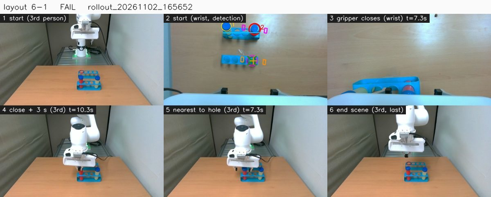

**D. 옆 구멍 쪽으로 감 — 9-2.** 쥔 채 랙 방향으로 31 mm = 바로 옆 구멍.

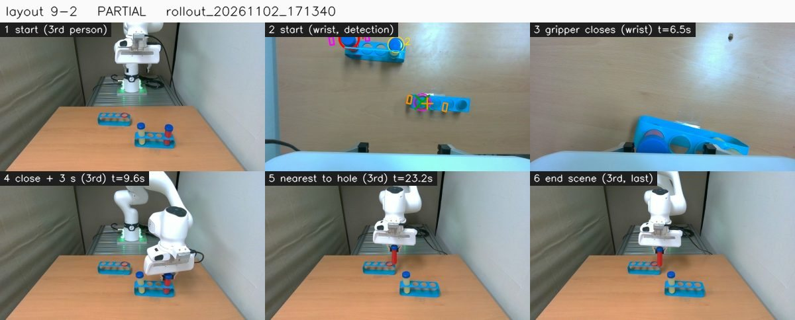

**E. 구멍 위까지 갔지만 못 들어감 — 13-1.** 구멍 바로 위(1 mm)까지 갔지만 학습 놓은 높이보다 47 mm 위에서 막힘 → 다음 행동이 0.1 s에 6.2 cm라 안전장치 중단.

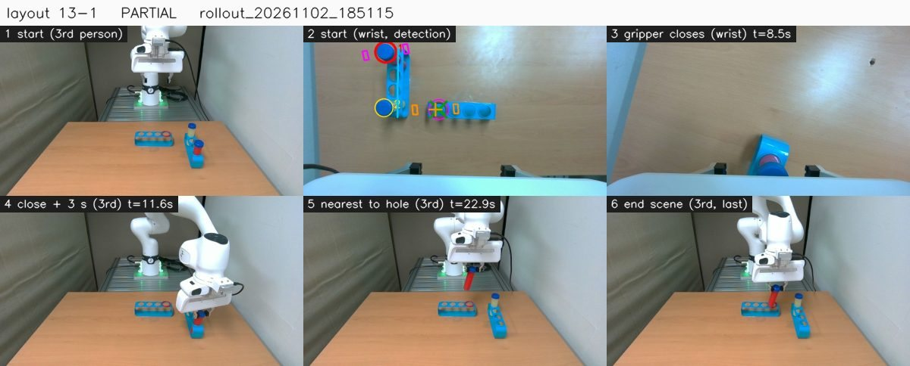

**F. 구멍 옆 높은 곳에서 놓음 — 13-2.** 구멍 12 mm 안까지 간 뒤, 65 mm 높이·구멍에서 38 mm 떨어진 곳에서 놓음.

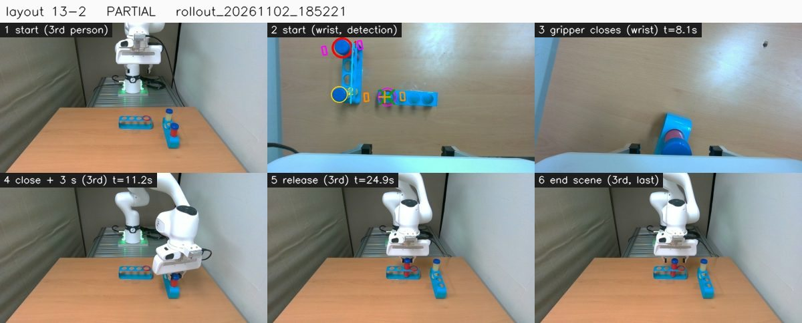

C(스테이션 제한 시간, 5-1·7-1)는 정책 실패가 아니라 사진을 넣지 않았습니다.

## 4. 배치별 결과

배치 그림은 [시작 3인칭 | 시작 손목(장면 찾기 표시) | 학습 데이터에서 튜브·구멍 위치가 가장 가까운 시행] 순서입니다. 시행 사진(한 장에 6칸, 순서는 3절 참고)은 유형별 대표 6회만 저장소에 넣었고, 해당 회차 표에 [사진] 링크가 있습니다.

"학습 최근접"은 √(Δ튜브² + Δ구멍²)가 가장 작은 학습 시행까지의 거리입니다(35 mm 이하 = 분포 안).

### 분포 안 배치 (13/16)

#### 배치 1 — 3/3 (학습 최근접 34 mm)
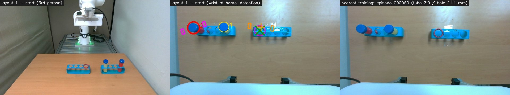

- **배치:** 튜브 랙은 왼쪽에 가로로 놓았고 빨간 튜브는 왼쪽 끝. 빈 랙은 오른쪽에 가로로 놓았고 빨간 링은 맨 왼쪽 구멍. 학습 059번과 비슷합니다.

| 회차 | 결과 | 기록 |
|---|---|---|
| 1 | 성공 | 닫은 자리 −7, −5 mm · 놓은 자리 구멍에서 14 mm · 테두리에 막힌 뒤 미끄러져 들어감 |
| 2 | 성공 | 닫은 자리 3 mm · 놓은 자리 8 mm |
| 3 | 성공 | 닫은 자리 3 mm · 놓은 자리 6 mm · 한 번에 꽂음 · [사진](results/images/trials/trial_01-3.jpg) |

#### 배치 2 — 3/3 (12 mm, 배치 1에서 빨간 링만 옮김)
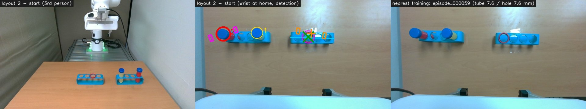

- **배치:** 랙은 그대로 두고 빨간 링만 두 번째 구멍으로 옮겼습니다.
- **해석:** 3회 모두 옮긴 구멍에 꽂았습니다(놓은 자리 6–8 mm). 정책이 외운 궤적을 재생하는 게 아니라, 영상에서 빨간 링을 보고 목표 구멍을 바꾼다는 근거입니다.

| 회차 | 결과 | 기록 |
|---|---|---|
| 1 | 성공 (자동 판정은 부분) | 닫은 자리 4 mm · 놓은 자리 6 mm |
| 2 | 성공 | 닫은 자리 5 mm · 놓은 자리 7 mm |
| 3 | 성공 | 닫은 자리 1 mm · 놓은 자리 8 mm |

#### 배치 6 — 1/3 (17 mm, 학습과 가까운 배치에서도 헛잡음)
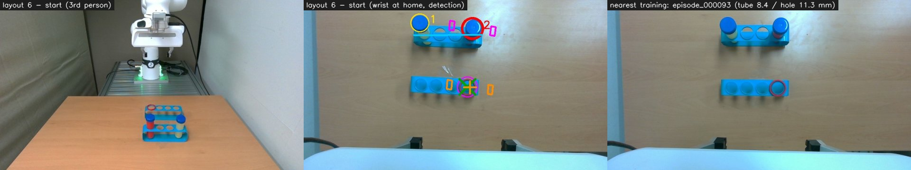

- **배치:** 튜브 랙은 먼 쪽 가운데에 가로로 놓았고 빨간 튜브는 오른쪽 끝. 빈 랙은 가까운 쪽 가운데에 가로로 놓았고 빨간 링은 맨 오른쪽 구멍. 학습 093번과 거의 같습니다.

| 회차 | 결과 | 유형 | 기록 |
|---|---|---|---|
| 1 | 실패 | B | 빨간 튜브 9 mm 옆, 학습보다 7 mm 높은 곳에서 닫음 · [사진](results/images/trials/trial_06-1.jpg) |
| 2 | 실패 | B | 같은 자리에서 헛잡음 → 다음 행동이 0.1 s에 5.6 cm라 안전장치 중단 |
| 3 | 성공 | — | 테두리에 닿은 뒤 들어감 |

#### 배치 10 — 2/3 (17 mm)
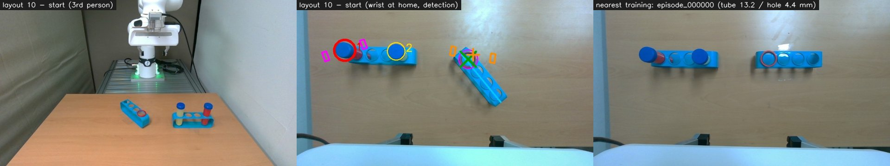

- **배치:** 튜브 랙은 왼쪽에 가로로 놓았고 빨간 튜브는 왼쪽 끝. 빈 랙은 오른쪽에 대각선으로 놓았고 빨간 링은 맨 위 구멍. 학습 000번 근처입니다.

| 회차 | 결과 | 유형 | 기록 |
|---|---|---|---|
| 1 | 부분 | E | 구멍 10 mm에서 막힘(18 mm). 멈춤 |
| 2 | 성공 | — | 놓은 자리 7 mm |
| 3 | 성공 (자동 판정은 부분) | — | 놓은 자리 12 mm |

#### 배치 11 — 3/3 (16 mm, 추가 10회 · 학습 배치 재현)
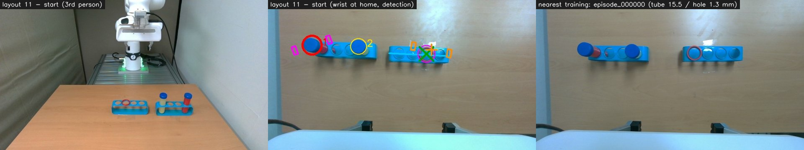

- **배치:** 튜브 랙은 왼쪽에 가로로 놓았고 빨간 튜브는 왼쪽 끝. 빈 랙은 오른쪽에 가로로 놓았고 빨간 링은 오른쪽에서 두 번째 구멍. 학습 000번과 구멍 위치가 1 mm 차이입니다(둘 다 40 mm 안 학습 8판).

| 회차 | 결과 | 기록 |
|---|---|---|
| 1 | 성공 (자동 판정은 부분 — 끝 장면에서 튜브를 못 찾음) | 닫은 자리 11 mm · 놓은 자리 12 mm |
| 2 | 성공 | 닫은 자리 9 mm · 놓은 자리 8 mm |
| 3 | 성공 | 닫은 자리 7 mm · 놓은 자리 7 mm |

#### 배치 14 — 1/1 (18 mm, 추가 10회 · 학습 배치 재현)
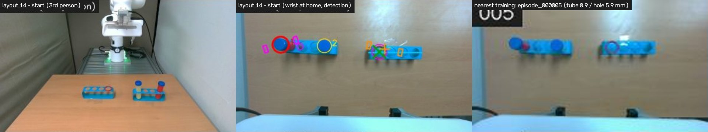

- **배치:** 배치 11과 비슷합니다. 튜브 랙은 왼쪽에 가로로 놓았고 빨간 튜브는 왼쪽 끝. 빈 랙은 오른쪽에 가로로 놓았고 빨간 링은 왼쪽에서 두 번째 구멍. 튜브 위치가 학습 005번과 1 mm 차이입니다.
- 메모는 "13-3"이었지만 별도 배치로 셌습니다(2절). 배치 사진은 시행 사진에서 잘라 해상도가 낮습니다.

| 회차 | 결과 | 기록 |
|---|---|---|
| 1 | 성공 (자동 판정은 부분) | 닫은 자리 5 mm · 놓은 자리 16 mm |

### 분포 밖 배치 (4/24)

#### 배치 3 — 0/3 (63 mm; 잡기·들기는 3/3, 꽂기에서 모두 실패)
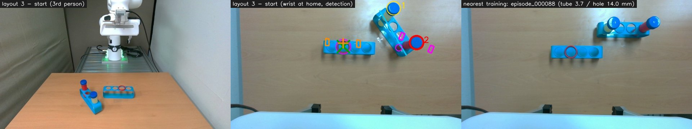

- **배치:** 빈 랙은 가운데 왼쪽에 가로로 놓았고 빨간 링은 맨 왼쪽 구멍. 튜브 랙은 오른쪽 위에 대각선으로 놓았고 빨간 튜브는 아래쪽 끝.
- **학습 데이터:** 튜브 위치는 학습과 2 mm지만, 튜브·구멍 조합으로는 63 mm 떨어집니다.

| 회차 | 결과 | 유형 | 기록 |
|---|---|---|---|
| 1 | 부분 | E | 구멍 8 mm 위에서 놓았지만 학습 놓은 높이보다 15 mm 높음 → 얹힘 (메모가 "10-3"으로 잘못 적혀 있어 시각·위치로 고침) |
| 2 | 부분 | E | 구멍 4 mm 위에서 9번 눌렀지만 들어가지 않음. 그 사이 빨간 링이 랙에서 밀려 떨어짐 |
| 3 | 부분 | D | 랙 방향으로 20 mm(옆 구멍 쪽) |

#### 배치 4 — 0/3 (114 mm, 다른 튜브 쪽으로 감)
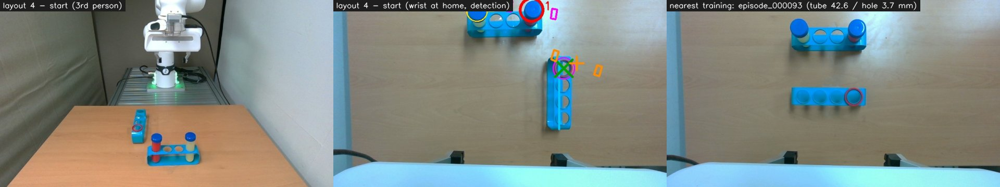

- **배치:** 튜브 랙은 먼 쪽 가운데에 가로로 놓았고, 빨간 튜브는 오른쪽 끝, 다른 튜브는 왼쪽 끝.
  - 튜브 x = 0.66 m로 학습 최대(0.653 m)보다 멀고, 시작 손목 사진 위쪽 끝에 걸칩니다.
  - 빈 랙은 오른쪽에 세로로 놓았고 빨간 링은 맨 위 구멍.
- **결과:** 3회 모두 빨간 튜브에서 약 12 cm 왼쪽(튜브 랙 반대쪽 끝)에서 닫았습니다. 흩어짐 4 mm, 학습보다 9–15 mm 낮게 닫았습니다.

| 회차 | 결과 | 유형 |
|---|---|---|
| 1 | 실패 | A |
| 2 | 실패 | A |
| 3 | 실패 | A |

#### 배치 5 — 2/3 (45 mm)
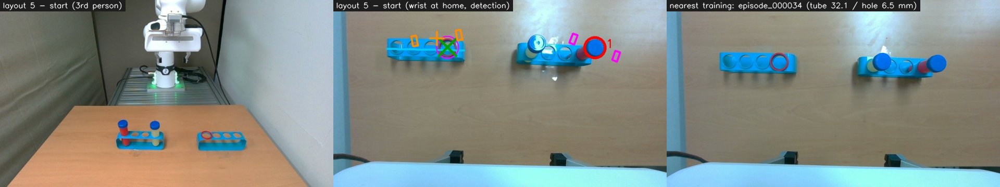

- **배치:** 빈 랙은 왼쪽에 가로로 놓았고 빨간 링은 맨 오른쪽 구멍. 튜브 랙은 오른쪽에 가로로 놓았고 빨간 튜브는 오른쪽 끝.
- **결과:** 잡는 자리가 3회 모두 같은 방향으로 약 19 mm 어긋났습니다(흩어짐 4 mm). 5-1·5-3은 쥔 폭이 25–27 mm로, 튜브를 한쪽으로 치우쳐 쥐었습니다.

| 회차 | 결과 | 유형 | 기록 |
|---|---|---|---|
| 1 | 부분 | C | 쥔 채 그리퍼 4 s 제한 시간으로 스테이션 중단 |
| 2 | 성공 (자동 판정은 부분) | — | 기준점과 17 mm 차이가 났지만 끝 장면에서 꽂혀 있음 |
| 3 | 성공 (자동 판정은 부분) | — | 기준점과 15 mm |

#### 배치 7 — 0/3 (63 mm)
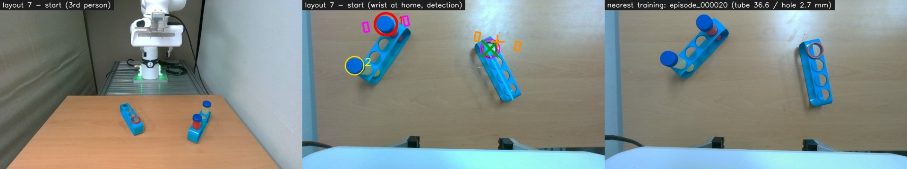

- **배치:** 튜브 랙은 왼쪽에 대각선으로 놓았고 빨간 튜브는 위쪽 끝. 빈 랙은 오른쪽에 대각선으로 놓았고 빨간 링은 맨 위 구멍. 학습 017–020번과 모양은 비슷하지만 튜브가 37 mm 떨어져 있습니다.
- **결과:** 잡는 자리가 같은 방향으로 약 19 mm 어긋났습니다(쥔 폭 27 mm).

| 회차 | 결과 | 유형 | 기록 |
|---|---|---|---|
| 1 | 부분 | C | 쥔 채 그리퍼 4 s 제한 시간으로 스테이션 중단 |
| 2 | 부분 | D | 랙 방향으로 23 mm(옆 구멍 쪽) |
| 3 | 부분 | E | 구멍 13 mm에서 막힘(실제가 명령보다 28 mm 위) |

#### 배치 8 — 0/3 (75 mm, 다른 튜브 쪽으로 감)
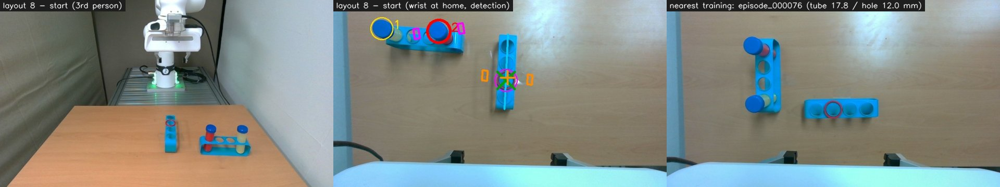

- **배치:** 튜브 랙은 먼 쪽 왼쪽에 가로로 놓았고, 빨간 튜브는 오른쪽 끝, 노란 튜브는 왼쪽 끝. 빈 랙은 가운데에 세로로 놓았고 빨간 링은 위에서 세 번째 구멍.
- **결과:** 3회 모두 빨간 튜브에서 약 14 cm 왼쪽, 노란 튜브 너머에서 닫았습니다(흩어짐 7 mm). 그 자리는 배치 1·2의 빨간 튜브 자리와 거의 같고, 학습에서 빨간 튜브를 잡은 자리 6판이 25 mm 안에 몰려 있는 곳입니다.

| 회차 | 결과 | 유형 |
|---|---|---|
| 1 | 실패 | A · [사진](results/images/trials/trial_08-1.jpg) |
| 2 | 실패 | A |
| 3 | 실패 | A |

#### 배치 9 — 0/3 (60 mm)
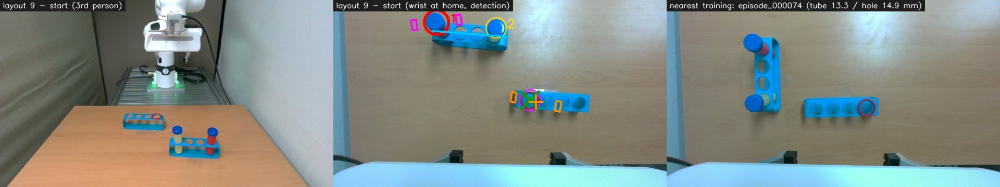

- **배치:** 튜브 랙은 먼 쪽 가운데-왼쪽에 가로로 놓았고 빨간 튜브는 왼쪽 끝. 빈 랙은 가까운 쪽 오른쪽에 가로로 놓았고 빨간 링은 맨 왼쪽 구멍.

| 회차 | 결과 | 유형 | 기록 |
|---|---|---|---|
| 1 | 부분 | E | 구멍 11 mm에서 막힘. 학습 놓은 높이보다 16 mm 위 |
| 2 | 부분 | D | 랙 방향으로 31 mm = 바로 옆 구멍 · [사진](results/images/trials/trial_09-2.jpg) |
| 3 | 실패 | B | 빨간 튜브 12 mm 옆, 학습보다 15 mm 높은 곳에서 닫음 |

#### 배치 12 — 2/3 (40 mm, 추가 10회 · 학습 배치 재현을 시도했지만 기준상 분포 밖)
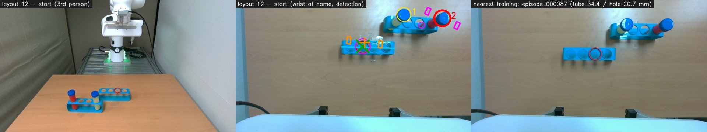

- **배치:** 튜브 랙은 먼 쪽 오른쪽에 가로로 놓았고 빨간 튜브는 오른쪽 끝. 빨간 튜브 y = −0.237 m로 학습 범위(−0.211 m)보다 오른쪽입니다. 빈 랙은 가운데에 가로로 놓았고 빨간 링은 왼쪽에서 두 번째 구멍. 학습 087번과 모양은 비슷하지만 튜브가 34 mm 떨어져 있어 기준(35 mm)을 조금 넘습니다.
- **결과:** 3회 모두 쥔 폭이 25 mm로, 튜브를 한쪽으로 치우쳐 쥐었습니다.

| 회차 | 결과 | 유형 | 기록 |
|---|---|---|---|
| 1 | 부분 | E | 구멍 5 mm 위에서 막힘(23 mm). 학습 놓은 높이보다 11 mm 위 |
| 2 | 성공 | — | 놓은 자리 9 mm |
| 3 | 성공 | — | 테두리에 닿은 뒤 들어감 |

1회와 2회 사이에 무효 1회가 있습니다(18:46). 랙을 제대로 고정하지 않은 준비 실수로, 튜브를 쥐고 49 mm 들어 올리던 중 랙이 함께 들렸습니다. 무효 규칙(준비 실수)에 따라 뺐고, 랙을 고정한 뒤 같은 배치로 다시 했습니다.

#### 배치 13 — 0/3 (47 mm, 추가 10회 · 학습 배치 재현을 시도했지만 기준상 분포 밖)
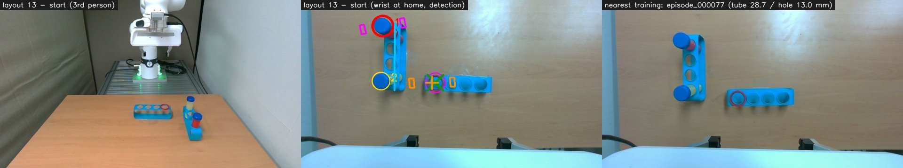

- **배치:** 튜브 랙은 왼쪽에 세로로 놓았고 빨간 튜브는 위쪽(먼 쪽) 끝. 빈 랙은 튜브 랙 아래쪽 끝 바로 오른쪽에 가로로 붙여 놓았고 빨간 링은 맨 왼쪽 구멍.
- **결과:** 3회 모두 잡기·들기는 정상이었습니다(닫은 자리 8–11 mm). 실패는 모두 꽂기에서 나왔습니다.

| 회차 | 결과 | 유형 | 기록 |
|---|---|---|---|
| 1 | 부분 | E | 구멍 바로 위(1 mm)까지 갔지만 학습 놓은 높이보다 47 mm 위에서 막힘(34 mm) → 다음 행동이 0.1 s에 6.2 cm라 안전장치 중단 · [사진](results/images/trials/trial_13-1.jpg) |
| 2 | 부분 | F | 구멍 12 mm 안까지 간 뒤, 65 mm 높이·구멍에서 38 mm 떨어진 곳에서 놓음 · [사진](results/images/trials/trial_13-2.jpg) |
| 3 | 부분 | E | 구멍 11 mm에서 막힘(26 mm). 학습 놓은 높이보다 23 mm 위 |

**무효 3회(통계 제외):** 사람이 무효로 표시했습니다.

- 17:00: 메모 "6-3". 튜브·구멍 위치가 배치 7과 1–2 cm 차이 납니다.
- 17:10: 메모 없음. 배치 8·9와 다른 배치입니다.
- 18:46: 배치 12. 랙 고정을 잘못해(준비 실수) 튜브와 함께 랙이 들림 → 랙을 고정하고 다시 함.

## 5. 데이터가 부족해서일까?

**결론: 주된 원인은 데이터의 "양"보다 "배치 다양성"입니다.** 100판이지만 실제로 다른 랙 배치는 약 30가지이고, 평가 배치 상당수가 그 사이의 새 조합이었습니다. 다만 23회 실패가 모두 데이터 문제는 아닙니다.

### 5.1 학습 데이터는 몇 가지 배치였나

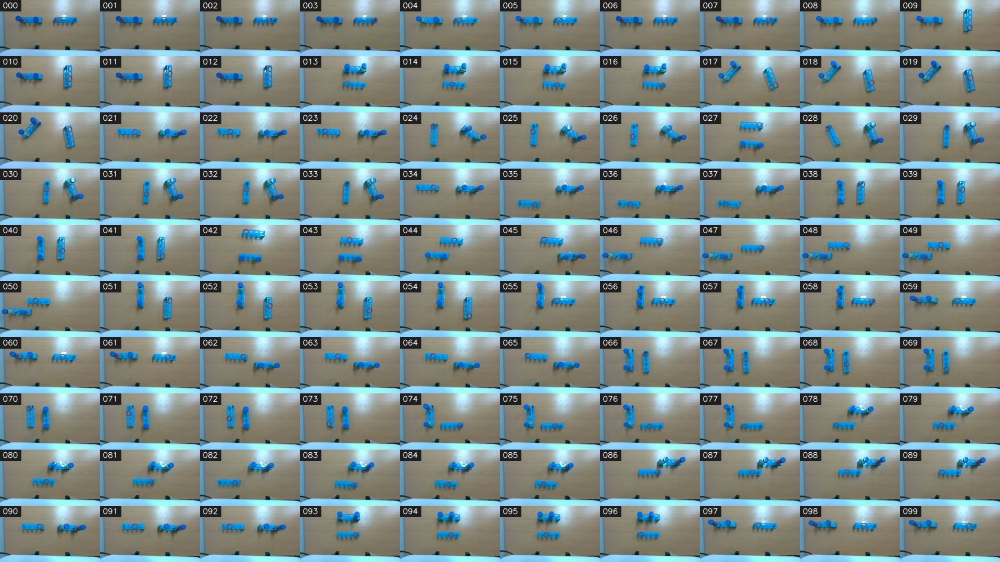

- 학습 100판은 같은 랙 배치에서 빨간 튜브 칸과 빨간 링 구멍만 바꿔 3–5판씩 이어 찍은 묶음들입니다.
  - 연속한 판의 랙 방향·위치로 자동으로 묶으면 32개, 사진으로 보면 약 25개입니다.
  - 학습 시행끼리 가장 가까운 이웃의 거리는 중간 33 mm입니다.
- 튜브 위치 범위는 x 0.455–0.653 m, y −0.211–0.274 m입니다.
- 빈 랙 방향(로봇 기준 각도)은 60–120°(사진에서 가로) 67판, 150–30°(세로에 가까움) 33판입니다.

### 5.2 학습 데이터와 먼 배치일수록 실패

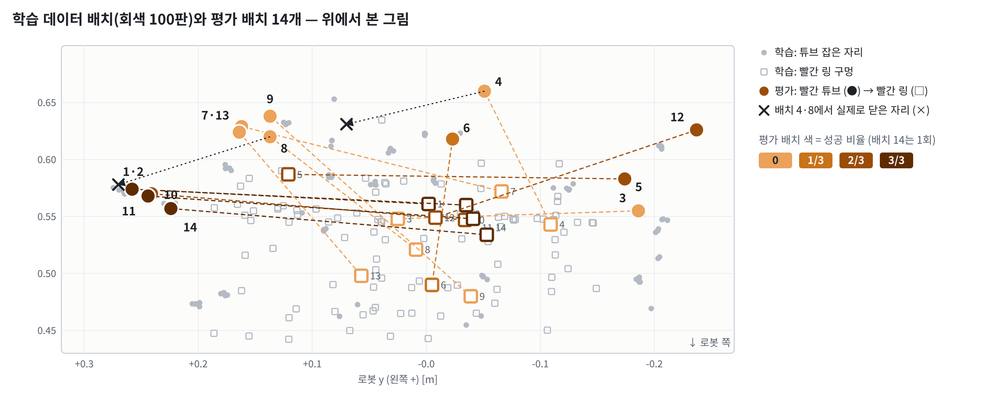

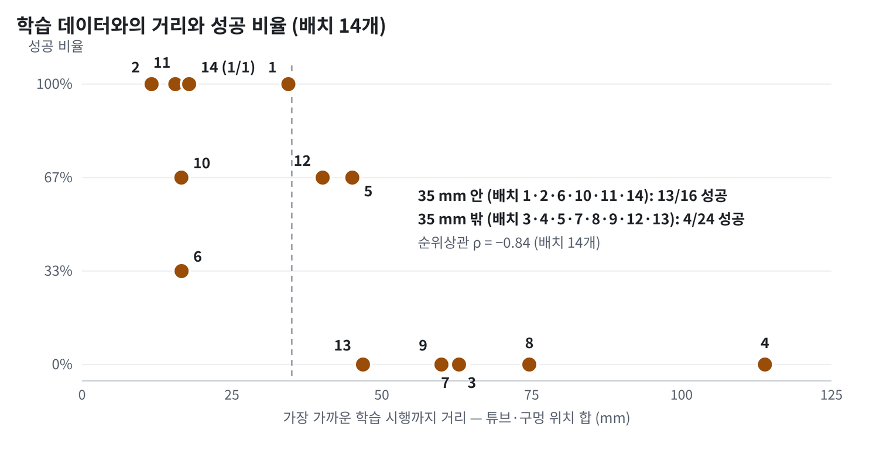

- 분포 안 6개 배치는 13/16, 분포 밖 8개 배치는 4/24였습니다.
- 배치 14개에서 성공 비율과 학습 최근접 거리의 순위상관은 **ρ = −0.84**입니다. 두 위치가 모두 40 mm 안인 학습 판 수와는 ρ = +0.86입니다.
- 튜브 위치 하나만 보면 상관이 약합니다. 배치 3은 튜브 위치가 학습과 2 mm였지만 0/3이었습니다. 정책에 필요한 건 개별 위치가 아니라 **튜브 랙과 빈 랙이 함께 놓인 조합**을 본 경험이라는 뜻입니다.
- 랙 각도만 따지면 실패한 배치들도 하나하나는 학습에 있던 각도(차이 0–10°)였습니다. 오히려 각도가 가장 낯설었던 배치 10(빈 랙 12°)은 2/3 성공했습니다.
- 기준(35 mm)은 처음 30회를 본 뒤 정했고, 배치 14개는 작은 표본입니다. 강한 상관까지만 말할 수 있고 인과는 아닙니다.

### 5.3 실패 유형별로 보면

- **A (다른 튜브 쪽, 6회) — 데이터 다양성 문제일 가능성이 높습니다.**
  - 두 배치(4·8) 모두 학습 조합에서 먼 쪽이었고(114·75 mm), 3회 모두 같은 자리를 골랐습니다.
  - 배치 8에서 닫은 자리는 학습에서 빨간 튜브를 자주 잡았던 자리(25 mm 안 6판)였습니다.
  - 학습 사진을 확대해 보면, 빨간 튜브가 대개 튜브 랙의 바깥쪽 끝(빈 랙에서 먼 쪽)에 있었습니다(확대해 본 20판 기준). 배치 4·8은 반대쪽 끝이었습니다.
  - "빨간색"보다 "익숙한 자리"를 따라간 지름길 학습으로 보입니다. 100판 전체는 `scripts/check_redpos.py`로 셀 수 있습니다.
- **D (옆 구멍, 3회) — 데이터 다양성 문제.** 모두 학습 조합에서 60 mm 넘게 떨어진 배치(3·7·9)에서 나왔고, 어긋남이 구멍이 늘어선 방향으로만 컸습니다.
- **E·F (구멍 위에서 막힘·높은 곳에서 놓음, 9회) — 대부분 분포 밖이지만 정밀도 한계도 섞임.**
  - 9회 중 8회가 분포 밖 배치(3·7·9·12·13)였습니다. 특히 배치 13(튜브 랙과 빈 랙을 바짝 붙인 배치)은 3회 모두 구멍 위에서 높이를 못 맞췄습니다.
  - 분포 안 배치 10에서도 1회 나왔습니다. 구멍과 튜브가 거의 딱 맞는 과제라 수 mm 어긋남이나 기울기에 막히는 정밀도 한계도 있습니다.
- **B (1 cm 헛잡음, 3회) — 정밀도.** 3회 중 2회가 분포 안 배치 6에서 나왔습니다.
- **잡는 자리는 고른 튜브를 정확히 따라갑니다.**
  - 올바른 튜브를 고른 12개 배치에서, 배치 평균 닫은 자리가 튜브 위치를 거의 그대로 따라갔습니다(기울기 x 0.98, y 1.00, R² 0.97·1.00).
  - 다만 튜브 30 mm 안에 학습 판이 없던 배치 4개(5·7·12·13) 중 5·7에서는 3회 모두 같은 방향으로 약 19 mm 어긋났습니다. 나머지 배치는 3–11 mm였습니다.
- **C (스테이션 제한 시간, 2회) — 코드 문제.** 쥐기 동작의 4 s 제한을 고치면 됩니다.

### 5.4 다음 데이터 수집에 대한 제안

1. 같은 배치를 여러 판 반복하기보다 **판마다 다른 랙 조합**으로 찍습니다(배치 수 ↑, 반복 ↓). 튜브 랙과 빈 랙의 상대 위치·방향을 고르게 섞고, 두 랙을 붙여 놓은 배치(배치 13)도 포함합니다.
2. 빨간 튜브를 튜브 랙의 **양쪽 끝과 가운데에 고르게** 놓고, 다른 색 튜브를 바깥 끝에 두는 판을 넣어 "자리" 지름길을 끊습니다.
3. 학습 범위 가장자리(먼 쪽 x > 0.63 m, y < −0.21 m, 세로·대각선 빈 랙)를 채웁니다.
4. 평가는 배치와 규칙을 미리 정하고(무작위 배치 포함), 배치당 시행보다 배치 수를 늘립니다.

## 6. 실행하며 관찰한 것과 기록으로 확인한 것

| 관찰 (실험자) | 기록으로 본 결과 |
|---|---|
| 빨간 링만 옮겨도 새 구멍을 잘 찾아 꽂았다 | 맞음. 배치 2에서 3/3, 놓은 자리 6–8 mm |
| 꽂을 때 구멍 옆을 누르면서 옆면을 타고 내려간다 | 맞음. 성공 17회 중 15회에서 구멍 30 mm 안에서 실제 손끝이 명령보다 6 mm 넘게 위에 머문 순간이 있었음(테두리·벽에 닿아 밀림). 관절 임피던스 제어의 순응성이 수 mm 오차를 흡수함. 이 값에는 따라가는 지연도 조금 섞여 있음 |
| 옆으로 내려갔다가 부딪히고 다시 올라와 꽂은 판이 있었다 | 규칙상 성공(시간 안 재시도) |
| 장면은 잘 인식했는데 노란 튜브 쪽으로 갔다 | 배치 4·8의 6회 모두. 5.3 A 참고 |
| 빈 랙이 멀어질수록 구멍을 잘 못 찾는 것 같다 | 빈 랙 거리 자체와는 관계가 뚜렷하지 않음. 꽂기 실패 배치의 빨간 링 x는 0.48–0.57 m, 성공 배치는 0.49–0.59 m로 겹침. 대신 튜브 랙이 학습보다 멀었던 배치 4(x 0.66 m)는 잡기부터 실패 |
| 잡는 자리가 옮기기 전 위치 쪽인 것 같다 | 배치 8에서 닫은 자리가 배치 1·2의 빨간 튜브 자리와 같았음. 하지만 GR00T는 판 사이를 기억하지 않음. 그 자리가 학습 데이터에서 빨간 튜브가 가장 자주 있던 곳이라서로 보는 게 맞음 |
| 한 번에 실행할 칸 8과 16 | 둘 다 성공 사례가 있었고, 8이 조금 더 자연스러워 보여 8로 정함(체계적 비교는 아님) |
| 같은 배치로 8번 하니 모두 성공 | 반복 정밀도는 높음(흩어짐 4 mm). 배치를 바꾸면 성공률이 크게 떨어져, 평가를 여러 배치로 바꾼 근거가 됨 |
| 학습 때 없던 배치까지 성공률에 넣는 건 불공평하다 | 그래서 분포 안·밖을 나눠 보고함(1절). 지우지 않고 남겨, 일반화 시험 결과로 함께 읽도록 함 |

## 7. 한계

- **표본:** 배치 14개 · 40회는 작습니다. 분포 안은 6개 배치 16회입니다.
- **추가 10회의 배치 선택:** 학습 배치를 눈으로 재현한 배치로, 실행 전에 적어 둔 무작위 방식과 달랐습니다. 학습 데이터에 가까운 쪽으로 치우쳐 있어 전체 성공률은 이 선택의 영향을 받습니다.
- **분포 안·밖 기준:** 처음 30회를 본 뒤 정한 사후 기준입니다. 거리는 튜브·구멍 위치만으로 쟀습니다(랙 방향·조명·가려짐 제외).
- **판정 기준점 오차:** 성공 판 기준 중간 8 mm, 최대 17 mm입니다. 판정은 끝 장면과 사람 확인으로 정했습니다.
- **스테이션 중단(C) 2회:** 정책 실패가 아니지만 규칙대로 부분으로 셌습니다.
- **무효 3회:** 모두 사람이 무효로 표시했습니다. 18:46은 랙 고정을 잘못한 준비 실수였고, 17:00·17:10은 사유 메모가 없습니다.
- **체크포인트:** 7k/14k/20k를 실물로 비교하지 않고 마지막(20k)을 썼습니다.
- **메모 오류 2건:** 3-1("10-3"으로 적힘), 14-1("13-3"으로 적힘). 이 폴더의 표와 그림은 고친 값입니다.

## 8. 파일

| 경로 | 내용 |
|---|---|
| `figs/` | 결과 그림 4장(한국어)과 학습 100판 시작 장면 모음. 논문용 영어판·PDF·SVG는 저장소에 넣지 않음 |
| `images/layouts/` | 배치 14개의 시작 장면과 가장 가까운 학습 시행 |
| `images/trials/` | 유형별 대표 6회의 사진(3절). 40회 전체와 무효 3회 사진은 `scripts/eval_report.py`로 다시 만들 수 있음 |
| `data/trials.csv` | 시행별 묶음(처음 30회/추가 10회)·분포·판정·실패 유형·측정값. 마지막 `사진` 열의 파일은 대표 6장만 저장소에 있음 |
| `data/layouts.csv` | 배치별 분포 안 여부·위치·랙 방향·잡기 오차·학습 데이터와의 거리 |
| `data/analysis.json` | 위 값 전체와 학습 100판의 튜브·구멍·랙 방향 |
| `scripts/eval_report.py` | 로봇 PC에서 위 사진·측정값을 만드는 스크립트(읽기만) |
| `scripts/eval_summary.py` | 성공률·단계·배치별 요약 |
| `scripts/check_redpos.py` | 빨간 튜브가 튜브 랙의 어느 쪽 끝에 있었는지 세기(학습 vs 평가) |
| `scripts/fig4_40.py`, `fig_eval40.py`, `svgkit.py` | 그림 다시 그리기 |

표의 경로는 `results/` 기준입니다. 다시 만들기 (로봇 PC, 로봇은 움직이지 않음, `results` 폴더에서):

```bash
python3 scripts/eval_report.py          # ~/eval_report/ 와 ~/eval_report.zip
python3 scripts/eval_summary.py         # 성공률 요약
python3 scripts/check_redpos.py         # 빨간 튜브 위치 편향 확인
```

그 뒤 평가의 파일 목록은 [`../FR3_results/`](../FR3_results/)(평가 2)와 [`../FR3_results_4exp_S0S9/`](../FR3_results_4exp_S0S9/)(평가 3) 각 README의 마지막 절에 있습니다.
